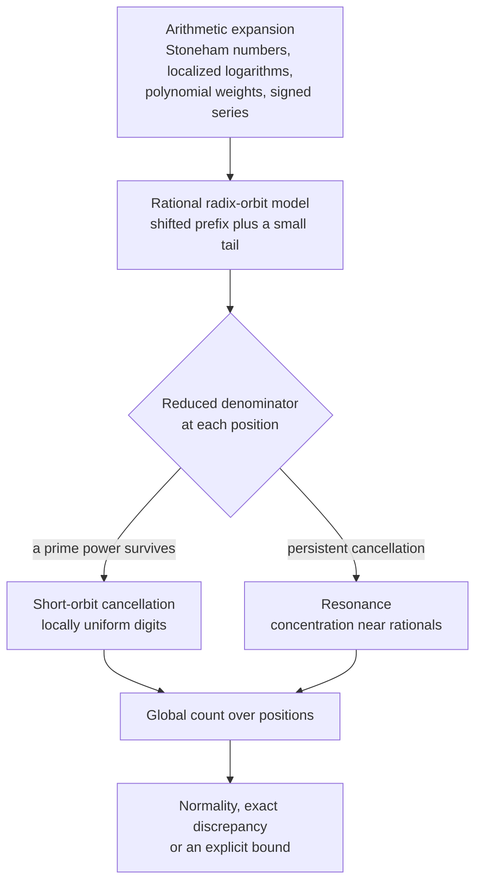

# Normality and Discrepancy of Arithmetic Expansions

[Manuscripts and PDFs](#research-papers) · [Proofs by topic](#results-by-topic) · [Reproduce and review](#reproduce-and-review)

## Principal theorems

### I. Polynomial images of Stoneham numbers

**Theorem I.** Let *b* ≥ 2 be an integer, let *p* be an odd prime that does not divide *b*, and let *e* be a positive integer. Define the Stoneham number

```math
\alpha = \sum_{j=1}^{\infty} \frac{1}{p^{ej} \, b^{p^{ej}}}.
```

For every polynomial *P* with rational coefficients and positive degree, *P*(α) is normal in base *b*. This means that each word of *h* digits has limiting frequency 1/*b*ʰ. Moreover, if *r*₁, …, *r*ₖ are distinct positive integers, the points

```math
\left( \{ b^n \alpha^{r_1} \}, \ \ldots, \ \{ b^n \alpha^{r_k} \} \right), \qquad n = 0, 1, 2, \ldots
```

are uniformly distributed in the unit cube [0, 1)ᵏ.

Thus every irrational element of the ring generated by α over the rationals is normal in base *b*. In particular the square, the cube and every higher power of the binary Stoneham number with *p* = 3 are binary normal, and the digits of distinct powers are jointly independent in the limit. By the equivalence of normality in a base and its positive integer powers, the classical Stoneham square is normal in every base 2ᵏ for *k* ≥ 1. In the square, distinct pairs of terms can enter at the same position. The proof accounts for these coincidences by reflecting the exponent coordinates so that the retained vectors form an upward-closed set. The numerator *K* of its generating function satisfies *K*(*p*) ≡ 1 (mod *p* − 1), so a growing prime power survives in every sufficiently late shifted denominator. The resulting modular orbit gives uniform digit frequencies.

[ST-01](docs/results.md#st-01) · [ST-05](docs/results.md#st-05) · [Lean polynomial theorem](NormalityChecker/StonehamPolynomial.lean#L112) · [Lean joint theorem](NormalityChecker/StonehamJoint.lean#L196) · [Proof](notes/stoneham-powers-products.md) · Paper [I](papers/01-stoneham-polynomials) · Related: [products on one prime axis](docs/results.md#st-02), [exact denominators of the square](docs/results.md#st-03)

<!-- BEGIN FIGURE stoneham-square-lattice -->
<p align="center">
<picture>
  <source media="(prefers-color-scheme: dark)" srcset="assets/figures/stoneham-square-lattice-dark.svg">
  
</picture>
</p>

<sub>Figure 1. At digit 270 the retained pairs form a lower set in the displayed exponents (*i*, *j*). Reflecting the coordinates to (5 − *i*, 5 − *j*) gives the upper set used in ST-01, restricted to the displayed indices. [Caption, data and generator](docs/figures.md#stoneham-square-lattice)</sub>
<!-- END FIGURE stoneham-square-lattice -->

### II. Complete classification on finite prime supports

For the first *N* fractional parts {*b*ⁿ*x*}, 0 ≤ *n* < *N*, write *D*<sub>*N*</sub>(*x*) for the supremum over half-open intervals in [0, 1) of the absolute difference between the observed frequency and the interval length. Write *D*∞(*x*) for its limit superior.

**Theorem II.** Let *b* ≥ 2 and *s* ≥ 1 be integers and let *P* be a finite set of primes. Let *S* consist of 1 and all larger integers whose prime factors lie in *P*, and put

```math
X = \sum_{m \in S} \frac{1}{m^s \, b^m}.
```

If some prime in *P* does not divide *b*, then *D*<sub>*N*</sub>(*X*) tends to 0 and *X* is normal in base *b*. If every prime in *P* divides *b*, then *D*<sub>*N*</sub>(*X*) tends to 1.

For a nonzero polynomial *Q* with rational coefficients, replace the numerator 1 by *Q*(*m*). The resulting sum is normal in base *b* exactly when *Q* vanishes at 0 to order less than *s* and some prime of *P* does not divide *b*.

These are restricted logarithms (*s* = 1) and polylogarithms (*s* ≥ 2). The zero-or-one discrepancy limit applies to the unsigned series on the full support, with numerator 1. Rational polynomial weights can give intermediate limits even on the full support. The proof identifies the limiting discrepancy with the measure of a persistent cancellation region, then shows that region is null by recurrence on a logarithmic circle, multiplicative finite differences and *p*-adic separation of finitely many geometric rays. Taking *P* to be all primes gives ln 2 when *b* = 2 and *s* = 1; these finite-support theorems say nothing about that case.

[LS-01](docs/results.md#ls-01) · [MW-01](docs/results.md#mw-01) · [Lean dichotomy](NormalityChecker/UnsignedNormality.lean#L194) · [Lean polynomial weights](NormalityChecker/FullPolynomialNormality.lean#L15) · [Proof](notes/unsigned-finite-support.md) · [Polynomial weights](notes/polynomial-masks.md) · Paper [II](papers/02-localized-normality) · Foundations: [exact persistent discrepancy](docs/results.md#ls-02), [nullity of persistent regions](docs/results.md#ls-03)

<!-- BEGIN FIGURE finite-support-classification -->
<p align="center">
<picture>
  <source media="(prefers-color-scheme: dark)" srcset="assets/figures/finite-support-classification-dark.svg">
  
</picture>
</p>

<sub>Figure 3. Normal or maximally discrepant: the limit of the interval discrepancy for each prime support and radix, as given by LS-01 for every order *s*. [Caption, data and generator](docs/figures.md#finite-support-classification)</sub>
<!-- END FIGURE finite-support-classification -->

### III. Exact discrepancy and resonance

**Theorem III.** Let *b* ≥ 2, let *p* be a prime not dividing *b*, and let *c*₀, *c*₁, … be a bounded sequence of integers. Put *a*₀ = *c*₀ and *a*ⱼ = *c*ⱼ − *p* *c*ⱼ₋₁ for *j* ≥ 1, and

```math
X = \sum_{j=0}^{\infty} \frac{a_j}{p^j \, b^{p^j}}.
```

Call the positions *p*ʲ ≤ *n* < *p*ʲ⁺¹ shell *j*, and let *Z*(*N*) count the positions *n* < *N* in shells with *c*ⱼ = 0. Then

1. *D*<sub>*N*</sub>(*X*) − *Z*(*N*)/*N* tends to 0, so *D*∞(*X*) is the upper density of positions in zero-phase shells.
2. for every nonzero integer *m* and rational *r*, *D*∞(*mX* + *r*) = *D*∞(*X*) · *D*(*r*), where *D*(*r*) is the interval discrepancy of the eventual periodic orbit of *r*.
3. the attainable values of *D*∞(*X*) are exactly the numbers

```math
V_p(s) = (p-1) \sum_{i=0}^{\infty} \frac{s_i}{p^{i+1}}
```

for binary sequences *s* that are lexicographically at least each of their own suffixes. This set does not depend on *b*.

On late nonzero shells the shifted points approach uniform distribution. On late zero shells their distances to integers tend to zero. The theorem therefore computes discrepancy exactly instead of bounding it. In base 2 with *p* = 3, the periodic phase words 1110, 10 and 100 give 27/40, 3/4 and 12/13. Translating by 1/3 multiplies these by 2/3, giving 9/20, 1/2 and 8/13. A cyclotomic test, also verified, decides normality of every finite rational combination of Stoneham-type components with an odd prime parameter, and produces nonnormal sums of normal numbers in every radix.

[DS-01](docs/results.md#ds-01) · [DS-03](docs/results.md#ds-03) · [DS-04](docs/results.md#ds-04) · [CR-01](docs/results.md#cr-01) · [Lean shell theorem](NormalityChecker/SignedShellDiscrepancy.lean#L144) · [Lean translation](NormalityChecker/TranslatedShells.lean#L221) · [Lean spectrum](NormalityChecker/ShellHistories.lean#L388) · [Proof](notes/signed-shell-discrepancy.md) · [Translations](notes/translated-shells.md) · [Spectrum](notes/attainable-shell-histories.md) · Paper [III](papers/03-signed-resonance)

<!-- BEGIN FIGURE translated-discrepancy -->
<p align="center">
<picture>
  <source media="(prefers-color-scheme: dark)" srcset="assets/figures/translated-discrepancy-dark.svg">
  
</picture>
</p>

<sub>Figure 5. Translation by 1/3 multiplies each exact discrepancy by 2/3, the discrepancy of the orbit of 1/3 (DS-03). [Caption, data and generator](docs/figures.md#translated-discrepancy)</sub>
<!-- END FIGURE translated-discrepancy -->

## How the results fit together

A radix shift can have a rational approximation that follows it for many digit positions. On a long interval, a growing denominator supported on a fixed set of primes can force uniform digit frequencies. Persistent cancellation can concentrate the orbit on a finite set. The proofs below combine these local estimates into statements about every sufficiently long prefix.

Every theorem above follows one pattern. The arrows are mathematical steps, not the order in which results were found.



The conclusions differ in strength, and the index labels each one.

| Conclusion | Meaning | Examples |
| --- | --- | --- |
| Normality | *D*∞ = 0; every block has its expected frequency | [ST-01](docs/results.md#st-01), [LS-01](docs/results.md#ls-01), [MW-01](docs/results.md#mw-01) |
| Exact asymptotic discrepancy | *D*∞ is computed exactly, often as a rational number | [DS-01](docs/results.md#ds-01), [DS-03](docs/results.md#ds-03), the value 1 in [LS-01](docs/results.md#ls-01) |
| Upper discrepancy bound | *D*∞ ≤ *c* for an explicit *c* < 1, with normality unknown | 43/45 for a product on two prime axes ([ST-06](docs/results.md#st-06)), 1 − 1/(*p* − 1) for masked supports |
| Positive uniform coverage | a positive share of positions is certified locally uniform | [AC-02](docs/results.md#ac-02); finite initial segments do not count |
| Unresolved certificate region | positions where no available test certifies anything | ln 2, π, *e* and the golden ratio |

[Framework and proof-dependency map](docs/framework.md) · [All figures](docs/figures.md)

## Research papers

The five manuscripts develop the verified results for mathematical review. Historical priority remains under investigation. [Comparison with earlier work](notes/reviewers.md#relation-to-prior-work). [Publication status and review reports](papers/README.md) · [Shared notation](papers/notation.md) · [Archiving and citation](papers/ARCHIVING.md)

<!-- BEGIN PAPERS -->
| | Manuscript | Results | Status | Files |
| --- | --- | --- | --- | --- |
| I | **Polynomial Images of Stoneham Numbers with an Odd Prime-Power Parameter** | [ST-01](docs/results.md#st-01) [ST-05](docs/results.md#st-05) [ST-02](docs/results.md#st-02) [ST-03](docs/results.md#st-03) | Internally reviewed | [PDF](papers/01-stoneham-polynomials/paper.pdf) · [LaTeX](papers/01-stoneham-polynomials/paper.tex) · [References](papers/01-stoneham-polynomials/references.bib) · [Reviewer guide](papers/01-stoneham-polynomials/REVIEW.md) |
| II | **Normality of Localized Logarithms and Polylogarithms on Finite Prime Supports** | [LS-01](docs/results.md#ls-01) [MW-01](docs/results.md#mw-01) [LS-02](docs/results.md#ls-02) [LS-03](docs/results.md#ls-03) | Internally reviewed | [PDF](papers/02-localized-normality/paper.pdf) · [LaTeX](papers/02-localized-normality/paper.tex) · [References](papers/02-localized-normality/references.bib) · [Reviewer guide](papers/02-localized-normality/REVIEW.md) |
| III | **Resonance and Discrepancy in Signed Stoneham Expansions** | [CR-01](docs/results.md#cr-01) [DS-01](docs/results.md#ds-01) [DS-03](docs/results.md#ds-03) [DS-04](docs/results.md#ds-04) | Internally reviewed | [PDF](papers/03-signed-resonance/paper.pdf) · [LaTeX](papers/03-signed-resonance/paper.tex) · [References](papers/03-signed-resonance/references.bib) · [Reviewer guide](papers/03-signed-resonance/REVIEW.md) |
| IV | **Arithmetic Certificates for Normality and Their Limitations** | [AC-01](docs/results.md#ac-01) [AC-02](docs/results.md#ac-02) [AC-03](docs/results.md#ac-03) | Internally reviewed | [PDF](papers/04-arithmetic-certificates/paper.pdf) · [LaTeX](papers/04-arithmetic-certificates/paper.tex) · [References](papers/04-arithmetic-certificates/references.bib) · [Reviewer guide](papers/04-arithmetic-certificates/REVIEW.md) |
| V | **Reduced Denominators of Binary Logarithm and Arctangent Series** | [CC-01](docs/results.md#cc-01) [CC-02](docs/results.md#cc-02) | Internally reviewed | [PDF](papers/05-classical-denominators/paper.pdf) · [LaTeX](papers/05-classical-denominators/paper.tex) · [References](papers/05-classical-denominators/references.bib) · [Reviewer guide](papers/05-classical-denominators/REVIEW.md) |

<details>
<summary>Abstracts</summary>

**I. Polynomial Images of Stoneham Numbers with an Odd Prime-Power Parameter.** For an odd prime *p* not dividing *b* and a positive integer *e*, every nonconstant rational polynomial in the Stoneham number with parameters *b* and *p*ᵉ is normal in base *b*, and distinct positive powers of that number have jointly uniformly distributed radix orbits. After reflection, the retained exponent vectors form an upward-closed set; the numerator of the resulting generating function is congruent to 1 modulo *p* − 1 at *z* = *p*, so a growing prime power survives at every sufficiently late shift. The paper also treats products along one prime axis, combinations with a unique leading monomial, the exact denominator profile of the binary Stoneham square, and strict upper discrepancy for products with multiplicatively independent parameters. The last result is a paper deduction, with a Lean bound of 43/45 for the binary product with parameters 3 and 5.

**II. Normality of Localized Logarithms and Polylogarithms on Finite Prime Supports.** Restrict the series for a polylogarithm of positive integer order to the integers whose prime factors lie in a finite set. With numerator 1 on the full support, the resulting radix expansion is normal when some support prime does not divide the radix, and its discrepancy tends to one otherwise. For a nonzero rational polynomial weight *P*(*m*) on the full support, normality holds exactly when *P* vanishes at zero to order less than *s* and some support prime does not divide the radix. The proof identifies the limiting discrepancy with the measure of a persistent cancellation region and shows that this region is null, using recurrence on a logarithmic circle, multiplicative finite differences and *p*-adic separation of finitely many geometric rays.

**III. Resonance and Discrepancy in Signed Stoneham Expansions.** A cyclotomic test decides normality of finite rational combinations of Stoneham-type components and produces nonnormal sums of normal numbers in every radix. For signed expansions with bounded phases, the asymptotic interval discrepancy equals the upper density of positions in zero-phase shells. Rational translation multiplies this discrepancy by the discrepancy of the rational orbit, and the attainable values are exactly the radix values of binary histories that dominate all of their suffixes in lexicographic order.

**IV. Arithmetic Certificates for Normality and Their Limitations.** Normality follows when most blocks of a radix orbit are approximated in mean by rational orbits whose denominators grow, are polynomially bounded and have prime factors in a fixed finite set. Partial coverage gives explicit discrepancy bounds, and overlapping certificates combine through endpoint paths and joint failure accounting. Two accurate smooth rational models on a common block must coincide modulo one, and a counting argument limits what such models can explain.

**V. Reduced Denominators of Binary Logarithm and Arctangent Series.** A finite dyadic identity for ln 2 has shifted binary prefixes whose reduced denominators grow at exponential rate one half, and this rate is optimal among finite dyadic logarithm identities, using Bang's primitive-divisor theorem. The paper studies corrected rational models, numerator residues, prime-power sieves, and analogous questions for π, *e* and rational arctangents. It does not establish normality, or an asymptotic discrepancy bound below one, for any of these constants.

</details>
<!-- END PAPERS -->

## Results by topic

The [curated result index](docs/results.md) gives every major result with its statement, scope, Lean declaration, proof, paper and kind of evidence. This survey keeps each family in view.

### Stoneham polynomial images and products

- **Polynomials, powers and products.** Every nonconstant rational polynomial in a Stoneham number with odd prime-power parameter is normal in the construction base. Products of Stoneham numbers along one odd prime axis, with arbitrary positive strides and radix dilations, are normal, and so is any rational combination with a unique monomial of top degree. [Proof for all degrees](notes/stoneham-powers-products.md) · [ST-01 to ST-05](docs/results.md#stoneham-polynomial-images-and-products)
- **The square.** The reduced denominator of every shifted prefix of the binary Stoneham square has an exact formula, with an exception at small scales. [Square denominator profile](notes/stoneham-square.md) · [ST-03](docs/results.md#st-03)
- **Products on different prime axes.** The product of the binary Stoneham numbers with parameters 3 and 5 is irrational and has binary discrepancy at most 43/45. Each ternary scale contains a long uniformly distributed window beside an isolated insertion. Full normality is open. [Lean estimate](NormalityChecker/ProductThreeFive.lean) · [Proof and transcendence corollary](notes/stoneham-powers-products.md#a-product-on-different-prime-axes)
- **Perturbations and other radices.** A Stoneham expansion tolerates perturbations at polynomial insertion times, including the dense linear identity. In radix three a separate paper proof gives superlinear growth of the number of distinct words in the binary Stoneham constant. [Perturbation theorem](NormalityChecker/PolynomialInsertions.lean) · [Ternary word complexity](notes/ternary-stoneham-complexity.md)

### Localized logarithms and polylogarithms

- **Unsigned full-support discrepancy dichotomy.** Theorem II above. Lean also proves the all-order, all-prefix formula for the exact discrepancy and identifies the maximum on the closure of the actual logarithmic phase flow. A base-36 counterexample shows why the deepest test alone can leave a prime in the denominator. [Lean all-prefix theorem](NormalityChecker/HigherOrderPrefix.lean) · [Lean phase maximum](NormalityChecker/HigherOrderPhase.lean) · [Proof for every order](notes/higher-order-joint.md) · [Order-two counterexample](notes/joint-persistent.md#higher-orders-and-the-lower-order-residues-paper-proof) · [Finite depth and a fixed masked counterexample](notes/fixed-depth-question.md)
- **One off-base prime at order one.** When exactly one prime *p* in *P* does not divide *b* and *s* = 1, let *Z* be the set of normalized positions in [1, *p*) that fail the modular test at every precision, and let *L*(*t*) be the length of the part of *Z* between 1 and *t*. Then

  ```math
  D_\infty = \max_{1 \le t \le p} \frac{L(p)/(p-1) + L(t)}{t},
  ```

  so the expansion is normal exactly when *Z* has measure zero. [Formal theorem](NormalityChecker/PersistentRegion.lean) · [Proof of the exact formula](notes/persistent-discrepancy.md)
- **Two generators and rates.** The logarithm restricted to products of powers of 2 and a fixed odd prime is binary normal with discrepancy of order 1/log log *N* under its radix hypotheses. Mixed generators extend normality to every positive order and to finite signed rational combinations on the same support. [Logarithms and discrepancy rate](notes/results.md#normality-of-two-generator-localized-logarithms) · [Composite generators](notes/composite-generators.md) · [Rational weights](NormalityChecker/RationalWeights.lean)

### Polynomial weights and masked supports

- **Masked supports.** Retain any subset of *S* containing all sufficiently late powers of a prime *p* that does not divide *b*. Then *D*∞ ≤ 1 − 1/(*p* − 1); retaining the powers of 2 gives normality in every odd radix. With an integer polynomial numerator vanishing at zero to order below *s*, retaining all late powers of 2 still gives normality in every odd radix. [Proof, bounded-gap masks and rational counterexamples](notes/polynomial-masks.md) · [Full rational classification](NormalityChecker/FullPolynomialNormality.lean) · [Lean valuation and tail bounds](NormalityChecker/PolynomialMasks.lean)
- **Dense, periodic and rational weights.** Telescoping proves normality for dense polynomial weights when the order exceeds the degree. For rational periodic weights at order one, a finite cyclic test decides normality for every period. Two rational polynomial families have discrepancy exactly 2/3. [Polynomial and periodic certificates](notes/polynomial-certificates.md) · [Arbitrary-period classification](NormalityChecker/PeriodicClassification.lean) · [MW-01 and related results](docs/results.md#polynomial-weights-and-masked-supports)

### Cyclotomic resonance and signed expansions

- **Finite Stoneham sums.** A cyclotomic divisibility test decides normality for rational combinations in the construction base. For the original binary components, the two-term sum with coefficients 1 and *a* is normal exactly when *a* differs from 2 and 2/3. Every nonempty positive rational combination in the base-10, prime-3 family is decimal normal. [General classification](NormalityChecker/CyclotomicClassification.lean) · [Binary checker and examples](notes/results.md#the-original-binary-checker) · [Decimal examples](NormalityChecker/CyclotomicExamples.lean)
- **Nonnormal sums of normal numbers.** In every radix some pairs of normal summands have an irrational nonnormal sum. For each threshold below one, some pair exceeds it in the upper limiting frequency of every all-zero word. A three-term binary example has two explicit subsequential distributions. [All-radix construction](notes/results.md#quantitative-nonnormality-in-every-radix) · [Distributions at resonant scales](NormalityChecker/CyclotomicDistribution.lean)

### Exact discrepancy and symbolic spectra

- **Signed shells, translations and the spectrum.** Theorem III above. De Bruijn translations give arbitrarily small positive discrepancy; the spectrum has an isolated zero, and its dimension and relation to symbolic dynamics have paper proofs. The irrational signed examples are transcendental by Roth or Ridout. [Translation, de Bruijn examples and rational division](notes/translated-shells.md) · [Spectrum, dimension and varying schedules](notes/attainable-shell-histories.md) · [Proof and transcendence](notes/signed-shell-discrepancy.md)

### Rational-orbit certificates

- **Certificates.** At each precision the checker partitions the digit positions into intervals. On a passing interval a prime power survives in the reduced denominator of a rational prefix, and cancellation in the resulting modular orbit controls the digit frequencies. Counting the remaining positions up to each endpoint gives a rational upper bound on *D*∞; only positions where every prime fails are charged. In the binary support {2, 5, 13}, the two first-precision tests give 0.234, and precision two proves normality. [Certificate theorem](NormalityChecker/DiscrepancyChecker.lean) · [Overlapping certificates](notes/overlapping-certificates.md) · [Joint bound](NormalityChecker/JointFiveThirteen.lean)
- **Approximate orbits.** Short modular orbits with a fixed finite prime support cancel even when several primes divide the denominator. Mean approximation error on good blocks suffices for normality. [Orbit estimate](NormalityChecker/SmoothOrbit.lean) · [Approximate certificate](NormalityChecker/ArithmeticCertificate.lean) · [Incomplete orbits](notes/results.md#finite-sums-and-incomplete-orbits) · [Polylogarithmic denominators](notes/denominators.md)

### Complementary coverage and rigidity

- **Partial coverage and its limits.** A share *g* covered by disjoint pieces of discrepancy at most *d* gives *D*∞ ≤ 1 − *g*(1 − *d*). Uniform frequencies of all eight-bit words give 1/128. Endpoint paths combine interval estimates across overlaps and incomplete blocks. On a common block, two accurate smooth rational models with polynomially bounded denominators coincide modulo one, and a counting argument limits what such models can explain. [Fixed-quality proof](notes/intermittent-coverage.md) · [Uniform shares](NormalityChecker/PartialUniformity.lean) · [Endpoint estimates](NormalityChecker/IntervalCoverage.lean) · [Overlap rigidity](NormalityChecker/OrbitRigidity.lean) · [Counting limits of smooth models](notes/finite-support-discrepancy.md#how-far-polynomial-denominator-models-can-reach)

### Classical constant arithmetic

None of the following establishes normality, or an asymptotic discrepancy bound below one, for ln 2, π, *e* or the golden ratio.

- **Denominators of ln 2.** A short prefix detects exactly when an odd prime power cancels in a shifted logarithm prefix, and the reduced denominator has logarithm asymptotic to the digit position. The identity below halves the exponential growth rate, and Lean verifies the exact rate one half. The proof of optimality among finite dyadic logarithm identities uses Bang's primitive-divisor theorem.

  ```math
  \ln 2 = 2 \sum_{j=1}^{\infty} \frac{1}{j \, 4^j} + \sum_{j=1}^{\infty} \frac{(-1)^{j+1}}{j \, 8^j}
  ```

  [Exact cancellation and quantitative loss](notes/results.md#the-two-arithmetic-milestones) · [Series, prime residues and optimality](notes/strided-logarithm.md) · [Lean series](NormalityChecker/StridedLogarithm.lean) · [CC-01 and CC-02](docs/results.md#classical-constant-arithmetic)
- **Models of ln 2.** Finite differences and beta corrections give longer rational models with explicit errors and denominator budgets. A binomial sum detects surviving primes in the diagonal model, whose small denominators occur on a set of upper Banach density zero. A prime-power sieve rules out low-transition words on finite windows. [Corrected models and prime survival](notes/log-shadow-primes.md) · [Corrected strides](notes/corrected-strides.md) · [Sieve and exact finite exclusions](notes/sublinear-residue-windows.md) · [Ordered normal approximations](notes/ordered-tail.md)
- **Binary transitions and Fourier criteria.** Binary discrepancy is below one exactly when digit transitions have positive lower density. For ln 2 there is an unconditional logarithmic transition count. A mean first-frequency deficit of 0.0128 in each four sufficiently late shells would give *D*∞ ≤ 0.9999 for ln 2. [Sharp transition theorem](notes/transition-discrepancy.md) · [Moment and dyadic criteria](notes/classical-discrepancy.md) · [Intermittent shells](notes/intermittent-coverage.md#intermittent-dyadic-shells) · [Fixed and growing lags](notes/results.md#polylogarithms-and-separated-positions)
- **π, *e*, quadratic irrationals and other logarithms.** Rational polynomial models give exact integral errors for logarithmic and hexadecimal BBP shifts, and specified congruence classes of primes survive in the BBP denominator of π. Binary discrepancy of the golden ratio is below one exactly when a positive lower density of powers of two have a bounded least Zeckendorf index. The factorial Taylor numerators of *e* have periodic residues, and the logarithms of 2ᵏ/(2ᵏ − 1) have denominator rate 1/*k*. [Chebyshev bound](NormalityChecker/ChebyshevModels.lean) · [BBP prime survival](NormalityChecker/BBPDenominator.lean) · [Hexadecimal observations for π](notes/intermittent-coverage.md#hexadecimal-observations-for-π) · [Fibonacci criterion](NormalityChecker/GoldenOrbit.lean) · [Gaussian arctangent denominators](notes/gaussian-arctangent-denominators.md) · [Proofs for *e*, π and natural logarithms](notes/classical-approximants.md) · [Complementary models](notes/complementary-models.md)

<!-- BEGIN FIGURE classical-denominator-growth -->
<p align="center">
<picture>
  <source media="(prefers-color-scheme: dark)" srcset="assets/figures/classical-denominator-growth-dark.svg">
  
</picture>
</p>

<sub>Figure 9. Shifted denominators of classical series grow exponentially, outside the polynomial range the certificates require. This says nothing about the normality of ln 2. [Caption, data and generator](docs/figures.md#classical-denominator-growth)</sub>
<!-- END FIGURE classical-denominator-growth -->

## Open problems and limitations

The following are **not** proved here. [Full list with partial results](docs/open-problems.md)

- Normality of ln 2, π and *e* in any base.
- Any asymptotic discrepancy bound strictly below one for these constants. In particular *D*∞ ≤ 0.9999 for the binary expansion of ln 2 remains open.
- Full normality of the product of the binary Stoneham numbers with parameters 3 and 5; only *D*∞ ≤ 43/45 is proved.
- Ternary normality of the standard binary Stoneham constant; only superlinear word complexity is known.
- Rational functions of Stoneham numbers, and polynomials in several independent Stoneham numbers beyond a unique leading monomial.
- Finite termination of the modular certificate on every full support; it is proved for two-prime supports and its limit is zero in general.
- Historical novelty of the results and independent expert review.

Normality of a logarithm restricted to finitely many primes does not imply normality of the unrestricted logarithm.

## Reading paths

- **New to the subject:** [a guided tour](docs/guide-newcomers.md) of normal numbers, Stoneham numbers and what the theorems add.
- **Mathematicians:** [how to check a theorem](docs/guide-mathematicians.md), from its statement through the written proof, literature and manuscript.
- **Lean reviewers:** [how to audit a formal statement](docs/guide-formal-review.md), its definitions, axioms and correspondence with the mathematics.

[Documentation hub](docs/README.md) · [Curated result index](docs/results.md) · [Complete declaration directory](docs/theorems.md) · [Research notes](notes/results.md) · [Research history](docs/history.md)

## Reproduce and review

[](https://github.com/eldernos/MathematicsResearch/actions/workflows/lean.yml)

The repository pins Lean and Mathlib to v4.36.0. With Elan installed, run these commands from the repository root.

```sh
export PATH="$HOME/.elan/bin:$PATH"
lake exe cache get $(sed -nE 's/^(public )?import (Mathlib\.[A-Za-z0-9_.]+)$/\2/p' NormalityChecker/*.lean NormalityChecker/Analysis/*.lean | sort -u)
scripts/verify.sh
```

Verification runs the exact-arithmetic tests, builds the library, audits the listed theorems for transitive axioms, checks the declaration directory and manifest against the compiled library, checks the documentation links, result identifiers and figures, and replays every project module through the Lean kernel. The audit permits `propext`, `Classical.choice` and `Quot.sound`. Checkpoint 11, the baseline of the manuscripts, is commit [`a09e011`](https://github.com/eldernos/MathematicsResearch/commit/a09e011720bc74396a27f4cb3ce2d8a5b3ce5035). [Verification guide](docs/verification.md) · [Axiom audit](Audit.lean) · [Workflow](.github/workflows/lean.yml) · [Checkpoint history](docs/history.md)

## Attribution, citation and contributing

The research and formalization are AI-assisted. Lean verification establishes that each formal statement follows from its definitions and the permitted axioms; whether a formal statement says what the prose claims, and whether a result is new, still needs human review. [How the work was done and what verification covers](docs/attribution.md) · [How to cite](docs/attribution.md#how-to-cite) · [Archiving and DOIs](papers/ARCHIVING.md)

Corrections, literature references and questions about a specific result are welcome as GitHub issues; quoting the result identifier helps. [Contributing](CONTRIBUTING.md) · Original contributions use the [MIT license](LICENSE); the port of Trevor Morris's Weyl criterion retains its [Apache-2.0 license](NormalityChecker/Analysis/Weyl.lean).

## Complete declaration directory

The directory links each named public theorem and lemma to its declaration, including the attributed port of the Weyl criterion. It is generated from the compiled library and checked on every build. A version grouped by topic, with docstring summaries and fully qualified names, is in [docs/theorems.md](docs/theorems.md); the machine-readable manifest is [declarations.json](docs/data/declarations.json).

<!-- BEGIN LEAN THEOREM INDEX -->
<details>
<summary>Browse all 779 public theorems and lemmas by Lean module</summary>

- **AdjacentShadow** · [pascal_prefix](NormalityChecker/AdjacentShadow.lean#L16) · [logShadow_adjacent_prime](NormalityChecker/AdjacentShadow.lean#L25) · [logShadow_adjacent_theta](NormalityChecker/AdjacentShadow.lean#L36) · [logShadow_adjacent_growth](NormalityChecker/AdjacentShadow.lean#L52)
- **AggregateGaps** · [gap_age_count_bound](NormalityChecker/AggregateGaps.lean#L36) · [hit_density_of_mean_age](NormalityChecker/AggregateGaps.lean#L48) · [logTwo_discrepancy_of_mean_age](NormalityChecker/AggregateGaps.lean#L78)
- **Analysis/Weyl** · [continuous_comp_coe](NormalityChecker/Analysis/Weyl.lean#L69) · [intervalIntegrable_comp_coe](NormalityChecker/Analysis/Weyl.lean#L73) · [cInt_add](NormalityChecker/Analysis/Weyl.lean#L77) · [cInt_smul](NormalityChecker/Analysis/Weyl.lean#L82) · [cMean_add](NormalityChecker/Analysis/Weyl.lean#L86) · [cMean_smul](NormalityChecker/Analysis/Weyl.lean#L91) · [norm_cMean_le](NormalityChecker/Analysis/Weyl.lean#L97) · [norm_cInt_le](NormalityChecker/Analysis/Weyl.lean#L111) · [cInt_fourier_ne](NormalityChecker/Analysis/Weyl.lean#L118) · [cInt_fourier_zero](NormalityChecker/Analysis/Weyl.lean#L137) · [cMean_eq_fourierMean](NormalityChecker/Analysis/Weyl.lean#L140) · [cgood_fourier](NormalityChecker/Analysis/Weyl.lean#L148) · [cgood_span](NormalityChecker/Analysis/Weyl.lean#L163) · [cgood_all](NormalityChecker/Analysis/Weyl.lean#L187) · [cgood_real](NormalityChecker/Analysis/Weyl.lean#L227) · [trapUp_nonneg](NormalityChecker/Analysis/Weyl.lean#L265) · [trapUp_le_one](NormalityChecker/Analysis/Weyl.lean#L269) · [trapLo_nonneg](NormalityChecker/Analysis/Weyl.lean#L272) · [trapLo_le_one](NormalityChecker/Analysis/Weyl.lean#L276) · [norm_coe_sub](NormalityChecker/Analysis/Weyl.lean#L280) · [norm_coe_ge](NormalityChecker/Analysis/Weyl.lean#L287) · [norm_coe_le](NormalityChecker/Analysis/Weyl.lean#L292) · [continuousR_comp](NormalityChecker/Analysis/Weyl.lean#L297) · [intIntegrableR](NormalityChecker/Analysis/Weyl.lean#L301) · [periodicR](NormalityChecker/Analysis/Weyl.lean#L305) · [intR_shift](NormalityChecker/Analysis/Weyl.lean#L310) · [trapUp_apply_of_close](NormalityChecker/Analysis/Weyl.lean#L315) · [trapLo_apply_of_close](NormalityChecker/Analysis/Weyl.lean#L321) · [integral_trapUp_le](NormalityChecker/Analysis/Weyl.lean#L328) · [le_integral_trapLo](NormalityChecker/Analysis/Weyl.lean#L384) · [le_abs_sub_int](NormalityChecker/Analysis/Weyl.lean#L432) · [trapUp_ge_indicator](NormalityChecker/Analysis/Weyl.lean#L451) · [trapLo_eq_zero_outside](NormalityChecker/Analysis/Weyl.lean#L465) · [equidistributed_of_weyl](NormalityChecker/Analysis/Weyl.lean#L487)
- **ApproximateDiscrepancy** · [approximate_interval_count_bound](NormalityChecker/ApproximateDiscrepancy.lean#L14)
- **ArithmeticCertificate** · [phase_model_sum_bound](NormalityChecker/ArithmeticCertificate.lean#L15) · [approximate_prefix_bound](NormalityChecker/ArithmeticCertificate.lean#L34) · [model_orbit_bound](NormalityChecker/ArithmeticCertificate.lean#L45) · [normal_of_approximate_arithmetic_certificate](NormalityChecker/ArithmeticCertificate.lean#L62) · [normal_of_arithmetic_certificate](NormalityChecker/ArithmeticCertificate.lean#L94)
- **BBPDenominator** · [unique_prime_denominator](NormalityChecker/BBPDenominator.lean#L13) · [prefix_upper_prime](NormalityChecker/BBPDenominator.lean#L44)
- **BBPShadow** · [integral_pi](NormalityChecker/BBPShadow.lean#L25) · [coefficient_integral](NormalityChecker/BBPShadow.lean#L43) · [shadow_integral](NormalityChecker/BBPShadow.lean#L81) · [shadow_error](NormalityChecker/BBPShadow.lean#L92) · [shadow_error_after_shifts](NormalityChecker/BBPShadow.lean#L112)
- **Basic** · [not_normal_of_frequent_excess](NormalityChecker/Basic.lean#L29)
- **BinaryDiscrepancy** · [frequency_bounds](NormalityChecker/BinaryDiscrepancy.lean#L27) · [interval_le_discrepancy](NormalityChecker/BinaryDiscrepancy.lean#L43) · [discrepancy_le](NormalityChecker/BinaryDiscrepancy.lean#L47) · [discrepancy_bounds](NormalityChecker/BinaryDiscrepancy.lean#L56) · [binary_shift_step](NormalityChecker/BinaryDiscrepancy.lean#L61) · [transition_iff_bits](NormalityChecker/BinaryDiscrepancy.lean#L76) · [discrepancy_le_transitions](NormalityChecker/BinaryDiscrepancy.lean#L110) · [asymptoticDiscrepancy_le_transitions](NormalityChecker/BinaryDiscrepancy.lean#L162) · [transition_near_interior](NormalityChecker/BinaryDiscrepancy.lean#L177) · [count_within_steps](NormalityChecker/BinaryDiscrepancy.lean#L195) · [interior_frequency_le_transitions](NormalityChecker/BinaryDiscrepancy.lean#L218) · [discrepancy_lt_one_iff_transitions](NormalityChecker/BinaryDiscrepancy.lean#L229) · [anchored_difference](NormalityChecker/BinaryDiscrepancy.lean#L266) · [normal_iff_discrepancy_zero](NormalityChecker/BinaryDiscrepancy.lean#L280)
- **BinomialShadow** · [logShadow_binomial_prime](NormalityChecker/BinomialShadow.lean#L67)
- **CellLimits** · [mean_at_scale](NormalityChecker/CellLimits.lean#L11)
- **CellModel** · [fixed_multiplier_orbit](NormalityChecker/CellModel.lean#L61) · [cell_orbit_approx](NormalityChecker/CellModel.lean#L74) · [cell_cancellation](NormalityChecker/CellModel.lean#L107)
- **CellProfile** · [coordinate_eq](NormalityChecker/CellProfile.lean#L13) · [bound_nonneg](NormalityChecker/CellProfile.lean#L31) · [score_le_bound](NormalityChecker/CellProfile.lean#L33) · [count_bound](NormalityChecker/CellProfile.lean#L46)
- **CertificateBlocks** · [card_insertionBlocks](NormalityChecker/CertificateBlocks.lean#L16) · [insertionBlocks_free](NormalityChecker/CertificateBlocks.lean#L19) · [split_blocks](NormalityChecker/CertificateBlocks.lean#L30) · [prefix_block_bound](NormalityChecker/CertificateBlocks.lean#L37) · [normal_of_sparse_blocks](NormalityChecker/CertificateBlocks.lean#L66)
- **ChangingShellSchedules** · [alternating_ratio_discrepancies](NormalityChecker/ChangingShellSchedules.lean#L19)
- **ChebyshevModels** · [chebScale_pos](NormalityChecker/ChebyshevModels.lean#L21) · [normalizedChebyshev_eval](NormalityChecker/ChebyshevModels.lean#L31) · [normalizedChebyshev_bound](NormalityChecker/ChebyshevModels.lean#L35) · [full_degree_log_error](NormalityChecker/ChebyshevModels.lean#L48)
- **CircleDiscrepancy** · [test_le](NormalityChecker/CircleDiscrepancy.lean#L23) · [disc_le](NormalityChecker/CircleDiscrepancy.lean#L27) · [disc_mixture_bound](NormalityChecker/CircleDiscrepancy.lean#L35) · [disc_sub_tendsto](NormalityChecker/CircleDiscrepancy.lean#L137)
- **CompositeLayers** · [mem_allowed](NormalityChecker/CompositeLayers.lean#L17) · [layer_injective](NormalityChecker/CompositeLayers.lean#L26) · [power_separated](NormalityChecker/CompositeLayers.lean#L41) · [separated_prefixes](NormalityChecker/CompositeLayers.lean#L80)
- **Concentration** · [not_normal_of_concentration](NormalityChecker/Concentration.lean#L20) · [not_normal_of_prefix_hits](NormalityChecker/Concentration.lean#L58) · [not_normal_of_grid_cell](NormalityChecker/Concentration.lean#L110)
- **CorrectedStrides** · [corrected_integral](NormalityChecker/CorrectedStrides.lean#L41) · [corrected_error](NormalityChecker/CorrectedStrides.lean#L56) · [beta_den](NormalityChecker/CorrectedStrides.lean#L74) · [corrected_den](NormalityChecker/CorrectedStrides.lean#L97) · [model_den](NormalityChecker/CorrectedStrides.lean#L113) · [model_error](NormalityChecker/CorrectedStrides.lean#L139)
- **Correlations** · [logPrefix_steps](NormalityChecker/Correlations.lean#L13) · [logPrefix_steps_bounds](NormalityChecker/Correlations.lean#L30) · [phase_add](NormalityChecker/Correlations.lean#L49) · [norm_phase](NormalityChecker/Correlations.lean#L52) · [phase_sub_le](NormalityChecker/Correlations.lean#L54) · [logPrefix_lag_character_bound](NormalityChecker/Correlations.lean#L64) · [mean_phase](NormalityChecker/Correlations.lean#L102) · [phase_fract](NormalityChecker/Correlations.lean#L107) · [normal_of_fourier](NormalityChecker/Correlations.lean#L113) · [binary_normal_of_odd_fourier](NormalityChecker/Correlations.lean#L129) · [fourierMean_zero_iff_of_error](NormalityChecker/Correlations.lean#L151) · [logTwo_normal_of_odd_prefix_fourier](NormalityChecker/Correlations.lean#L171)
- **CyclotomicCell** · [model](NormalityChecker/CyclotomicCell.lean#L66)
- **CyclotomicClassification** · [cyclotomic_fourier_limit](NormalityChecker/CyclotomicClassification.lean#L83) · [cyclotomic_normal_iff](NormalityChecker/CyclotomicClassification.lean#L99)
- **CyclotomicDistribution** · [circle_mixture_of_characters](NormalityChecker/CyclotomicDistribution.lean#L12) · [cyclotomic_distribution](NormalityChecker/CyclotomicDistribution.lean#L74)
- **CyclotomicExamples** · [binary_cyclotomic_cell](NormalityChecker/CyclotomicExamples.lean#L12) · [cyclotomicTest_binary_eq](NormalityChecker/CyclotomicExamples.lean#L21) · [positive_sum_of_order_one](NormalityChecker/CyclotomicExamples.lean#L28) · [decimal_positive_normal](NormalityChecker/CyclotomicExamples.lean#L40) · [seventh_triple_not_normal](NormalityChecker/CyclotomicExamples.lean#L45) · [seventh_triple_masses](NormalityChecker/CyclotomicExamples.lean#L57) · [seventh_triple_distributions](NormalityChecker/CyclotomicExamples.lean#L65)
- **CyclotomicFourier** · [character](NormalityChecker/CyclotomicFourier.lean#L53)
- **CyclotomicLift** · [exists_inverse_lift](NormalityChecker/CyclotomicLift.lean#L21) · [inverse_lift_precision](NormalityChecker/CyclotomicLift.lean#L53) · [lift_eval_zero_iff](NormalityChecker/CyclotomicLift.lean#L76)
- **CyclotomicTest** · [residueOrder_eq](NormalityChecker/CyclotomicTest.lean#L15) · [vanishes_iff](NormalityChecker/CyclotomicTest.lean#L137) · [resonanceWitnesses_eq](NormalityChecker/CyclotomicTest.lean#L197) · [cyclotomicNormalTest_correct](NormalityChecker/CyclotomicTest.lean#L211)
- **DeepCancellation** · [integral_of_deep_cell](NormalityChecker/DeepCancellation.lean#L13) · [deep_count_bound](NormalityChecker/DeepCancellation.lean#L42) · [deep_scale_count](NormalityChecker/DeepCancellation.lean#L84) · [normal_iff_shrinking_cells](NormalityChecker/DeepCancellation.lean#L100)
- **DenominatorGrowth** · [small_log_bound](NormalityChecker/DenominatorGrowth.lean#L20) · [log_lcm_le](NormalityChecker/DenominatorGrowth.lean#L78) · [logLoss_nonneg](NormalityChecker/DenominatorGrowth.lean#L106) · [logLoss_le_of_le_cube](NormalityChecker/DenominatorGrowth.lean#L112) · [root_cube](NormalityChecker/DenominatorGrowth.lean#L129) · [logLoss_le](NormalityChecker/DenominatorGrowth.lean#L133) · [logLoss_isBigO](NormalityChecker/DenominatorGrowth.lean#L155) · [tendsto_logDen_div](NormalityChecker/DenominatorGrowth.lean#L162) · [reciprocal_logDen](NormalityChecker/DenominatorGrowth.lean#L181) · [logPrefix_eventually_avoids_residues](NormalityChecker/DenominatorGrowth.lean#L197)
- **DensePolynomial** · [exists_radix_antidifference](NormalityChecker/DensePolynomial.lean#L15) · [power_interval_boundaries](NormalityChecker/DensePolynomial.lean#L40) · [dense_boundary_identity](NormalityChecker/DensePolynomial.lean#L74) · [dense_polynomial_identity](NormalityChecker/DensePolynomial.lean#L90) · [normal_of_polynomial_boundaries](NormalityChecker/DensePolynomial.lean#L100) · [dense_polynomial_normal](NormalityChecker/DensePolynomial.lean#L118) · [dense_linear_ternary_identity](NormalityChecker/DensePolynomial.lean#L127) · [dense_linear_ternary_normal](NormalityChecker/DensePolynomial.lean#L149) · [periodic_plateau_zero](NormalityChecker/DensePolynomial.lean#L155)
- **DiagonalNumerator** · [scaled_eq](NormalityChecker/DiagonalNumerator.lean#L17) · [residue_step](NormalityChecker/DiagonalNumerator.lean#L40) · [paired_residues](NormalityChecker/DiagonalNumerator.lean#L135)
- **DiagonalStep** · [logShadow_diagonal_step](NormalityChecker/DiagonalStep.lean#L12) · [logShadow_diagonal_lcm](NormalityChecker/DiagonalStep.lean#L30) · [logShadow_diagonal_max](NormalityChecker/DiagonalStep.lean#L52)
- **Dilation** · [phase_conj](NormalityChecker/Dilation.lean#L38) · [mean_zero_of_orthogonal_shifts](NormalityChecker/Dilation.lean#L43) · [shifted_character_correlation](NormalityChecker/Dilation.lean#L102) · [normal_of_dilated_fourier](NormalityChecker/Dilation.lean#L114) · [binary_normal_of_dilated_fourier](NormalityChecker/Dilation.lean#L139)
- **DiscrepancyChecker** · [failed_cell_refines](NormalityChecker/DiscrepancyChecker.lean#L33) · [passing_cell_survives](NormalityChecker/DiscrepancyChecker.lean#L69) · [discrepancy_of_cell_cover](NormalityChecker/DiscrepancyChecker.lean#L98) · [discrepancy_of_joint_failures](NormalityChecker/DiscrepancyChecker.lean#L113) · [five_thirteen_first_failures](NormalityChecker/DiscrepancyChecker.lean#L141) · [discrepancy_le_certificate](NormalityChecker/DiscrepancyChecker.lean#L146) · [five_thirteen_precision_two](NormalityChecker/DiscrepancyChecker.lean#L153) · [five_thirteen_binary_normal](NormalityChecker/DiscrepancyChecker.lean#L156) · [normal_of_shrinking_cells](NormalityChecker/DiscrepancyChecker.lean#L165) · [discrepancy_le_of_support_prime](NormalityChecker/DiscrepancyChecker.lean#L210) · [base_seven_certificate_values](NormalityChecker/DiscrepancyChecker.lean#L242)
- **Distribution** · [normalIn_iff_uniform](NormalityChecker/Distribution.lean#L146) · [uniformModOne_of_error](NormalityChecker/Distribution.lean#L183) · [normalIn_iff_uniform_approx](NormalityChecker/Distribution.lean#L221) · [anchored_frequency_of_normal](NormalityChecker/Distribution.lean#L229)
- **DominatedPerturbation** · [normal_of_dominated_perturbation](NormalityChecker/DominatedPerturbation.lean#L16)
- **DyadicEscape** · [dyadic_prefix_lower](NormalityChecker/DyadicEscape.lean#L14) · [logTwo_discrepancy_of_dyadic_escape](NormalityChecker/DyadicEscape.lean#L60)
- **DyadicLogRates** · [polylog_first_den_rate](NormalityChecker/DyadicLogRates.lean#L13) · [dyadicLogPrefix_eq](NormalityChecker/DyadicLogRates.lean#L34) · [dyadicLogPrefix_rate](NormalityChecker/DyadicLogRates.lean#L40)
- **DyadicRelations** · [coefficients_of_valuations](NormalityChecker/DyadicRelations.lean#L14) · [strict_half_of_first_band](NormalityChecker/DyadicRelations.lean#L54) · [optimal_rate](NormalityChecker/DyadicRelations.lean#L94)
- **ExactProfile** · [certificate_tendsTo_discrepancy](NormalityChecker/ExactProfile.lean#L60)
- **FactorialNumerators** · [taylor_sum](NormalityChecker/FactorialNumerators.lean#L15) · [periodic_residue](NormalityChecker/FactorialNumerators.lean#L23) · [paired_zeros](NormalityChecker/FactorialNumerators.lean#L55)
- **FiniteClassification** · [weightDen_pos](NormalityChecker/FiniteClassification.lean#L37) · [integerWeight_spec](NormalityChecker/FiniteClassification.lean#L40) · [normal_of_nonresonance](NormalityChecker/FiniteClassification.lean#L76) · [not_normal_of_resonance](NormalityChecker/FiniteClassification.lean#L98) · [finite_normal_iff](NormalityChecker/FiniteClassification.lean#L117) · [binaryNormalTest_correct](NormalityChecker/FiniteClassification.lean#L129) · [three_component_resonance](NormalityChecker/FiniteClassification.lean#L136) · [component_binary_normal](NormalityChecker/FiniteClassification.lean#L141) · [ordered_sum_binary_normal](NormalityChecker/FiniteClassification.lean#L147) · [two_component_normal_iff](NormalityChecker/FiniteClassification.lean#L166)
- **FirstFrequency** · [escapeAverage_transition_bounds](NormalityChecker/FirstFrequency.lean#L65) · [first_frequency_bounds](NormalityChecker/FirstFrequency.lean#L83) · [logTwo_discrepancy_lt_one_iff_escape](NormalityChecker/FirstFrequency.lean#L116) · [logTwo_escape_logarithmic](NormalityChecker/FirstFrequency.lean#L139)
- **FixedGap** · [fixed_window_count](NormalityChecker/FixedGap.lean#L18) · [logTwo_density_of_fixed_window](NormalityChecker/FixedGap.lean#L29) · [logTwo_discrepancy_of_fixed_window](NormalityChecker/FixedGap.lean#L52) · [middle_miss_intervals](NormalityChecker/FixedGap.lean#L59) · [middle_miss_volume](NormalityChecker/FixedGap.lean#L85)
- **FourierTest** · [fourier_of_normal](NormalityChecker/FourierTest.lean#L14) · [normalIn_iff_prefix_fourier](NormalityChecker/FourierTest.lean#L95) · [binary_normal_iff_odd_prefix_fourier](NormalityChecker/FourierTest.lean#L107) · [normal_mul_nat_iff](NormalityChecker/FourierTest.lean#L119) · [normal_add_rat_iff](NormalityChecker/FourierTest.lean#L133) · [normalIn_iff_lag_differences](NormalityChecker/FourierTest.lean#L157) · [logTwo_normal_iff_odd_prefix_fourier](NormalityChecker/FourierTest.lean#L167) · [logTwo_normal_iff_lag_fourier](NormalityChecker/FourierTest.lean#L174) · [logTwo_not_normal_iff_odd_bias](NormalityChecker/FourierTest.lean#L183) · [logTwo_normal_iff_dyadic_lag_cancellation](NormalityChecker/FourierTest.lean#L190)
- **FullPolynomialNormality** · [full_rational_normal_iff](NormalityChecker/FullPolynomialNormality.lean#L15)
- **GeneralResonance** · [odd_radix_lift](NormalityChecker/GeneralResonance.lean#L14) · [radix_pair_tail](NormalityChecker/GeneralResonance.lean#L84) · [radix_pair_zero_limsup](NormalityChecker/GeneralResonance.lean#L113) · [radix_pair_not_normal](NormalityChecker/GeneralResonance.lean#L132) · [radix_pair_irrational](NormalityChecker/GeneralResonance.lean#L148) · [oddSquareDivisor_spec](NormalityChecker/GeneralResonance.lean#L174) · [all_base_resonance](NormalityChecker/GeneralResonance.lean#L186) · [severe_resonance](NormalityChecker/GeneralResonance.lean#L200) · [binary_zero_block_limsup](NormalityChecker/GeneralResonance.lean#L240)
- **GoldenCongruence** · [golden_high_indices_in_every_class](NormalityChecker/GoldenCongruence.lean#L36)
- **GoldenDigits** · [golden_floor_mod_two](NormalityChecker/GoldenDigits.lean#L42) · [golden_bit_readout](NormalityChecker/GoldenDigits.lean#L50)
- **GoldenOrbit** · [golden_fibonacci_identity](NormalityChecker/GoldenOrbit.lean#L37) · [golden_least_bounds](NormalityChecker/GoldenOrbit.lean#L70) · [golden_normal_equivalences](NormalityChecker/GoldenOrbit.lean#L100) · [zeckendorf_nonempty](NormalityChecker/GoldenOrbit.lean#L111) · [golden_zeckendorf_bounds](NormalityChecker/GoldenOrbit.lean#L153) · [golden_floor_zeckendorf](NormalityChecker/GoldenOrbit.lean#L161) · [golden_discrepancy_iff_small_index](NormalityChecker/GoldenOrbit.lean#L190)
- **GrowingLags** · [logPrefix_drift_bounds](NormalityChecker/GrowingLags.lean#L12) · [logPrefix_centered_lag_bound](NormalityChecker/GrowingLags.lean#L36) · [logPrefix_dyadic_lag_limit](NormalityChecker/GrowingLags.lean#L53)
- **HigherOrderCells** · [reduce_inverse_radix](NormalityChecker/HigherOrderCells.lean#L28) · [phaseMoment_reduction](NormalityChecker/HigherOrderCells.lean#L49) · [failedRegion_iff_phaseReduction_zero](NormalityChecker/HigherOrderCells.lean#L82) · [persistent_iff_phaseMoment_zero](NormalityChecker/HigherOrderCells.lean#L118)
- **HigherOrderDiscrepancy** · [prefix_discrepancy_lower](NormalityChecker/HigherOrderDiscrepancy.lean#L29) · [prefix_discrepancy_of_survival](NormalityChecker/HigherOrderDiscrepancy.lean#L101) · [prefix_discrepancy_upper](NormalityChecker/HigherOrderDiscrepancy.lean#L150) · [prefix_discrepancy_tendsTo_one](NormalityChecker/HigherOrderDiscrepancy.lean#L161)
- **HigherOrderDominance** · [stride_coefficient_identity](NormalityChecker/HigherOrderDominance.lean#L26) · [principal_coefficients_bounded](NormalityChecker/HigherOrderDominance.lean#L103) · [dominant_order_denominator](NormalityChecker/HigherOrderDominance.lean#L157)
- **HigherOrderPhase** · [compactPhaseScore_cutoff](NormalityChecker/HigherOrderPhase.lean#L91) · [continuous_compactPhaseScore](NormalityChecker/HigherOrderPhase.lean#L199) · [discrepancy_tracks_compactPhaseScore](NormalityChecker/HigherOrderPhase.lean#L236) · [discrepancy_eq_attainable_max](NormalityChecker/HigherOrderPhase.lean#L249) · [log_nat_flow_cluster](NormalityChecker/HigherOrderPhase.lean#L313) · [attainable_angles_eq_flow_closure](NormalityChecker/HigherOrderPhase.lean#L357) · [discrepancy_eq_log_flow_max](NormalityChecker/HigherOrderPhase.lean#L412)
- **HigherOrderPrefix** · [phase_digit](NormalityChecker/HigherOrderPrefix.lean#L18) · [prefix_finite](NormalityChecker/HigherOrderPrefix.lean#L43) · [digitPhase_prefix_bound](NormalityChecker/HigherOrderPrefix.lean#L83) · [jointPhase_prefix_lower](NormalityChecker/HigherOrderPrefix.lean#L175) · [discrepancy_tracks_jointPhase](NormalityChecker/HigherOrderPrefix.lean#L276) · [prefixMass_compare](NormalityChecker/HigherOrderPrefix.lean#L352) · [jointOrder_density_tendsTo_discrepancy](NormalityChecker/HigherOrderPrefix.lean#L370)
- **HigherOrderPrincipal** · [inverse_radix_factors](NormalityChecker/HigherOrderPrincipal.lean#L23) · [principalPolynomial_eval](NormalityChecker/HigherOrderPrincipal.lean#L82) · [eval_split](NormalityChecker/HigherOrderPrincipal.lean#L103) · [principal_prefix_identity](NormalityChecker/HigherOrderPrincipal.lean#L115) · [fixed_frobenius](NormalityChecker/HigherOrderPrincipal.lean#L151) · [phaseMoment_tail](NormalityChecker/HigherOrderPrincipal.lean#L186) · [frozenMoment_phase](NormalityChecker/HigherOrderPrincipal.lean#L201) · [phase_prefix_identity](NormalityChecker/HigherOrderPrincipal.lean#L242) · [prime_cleared_of_phase_zeros](NormalityChecker/HigherOrderPrincipal.lean#L268)
- **IndexedExpansion** · [indexed_shift_error_signed](NormalityChecker/IndexedExpansion.lean#L13) · [indexed_shift_error](NormalityChecker/IndexedExpansion.lean#L63)
- **Insertion** · [insertion_prefix](NormalityChecker/Insertion.lean#L35) · [component_orbit_approx](NormalityChecker/Insertion.lean#L89) · [finite_orbit_approx](NormalityChecker/Insertion.lean#L111)
- **IntervalCoverage** · [endpoint_path](NormalityChecker/IntervalCoverage.lean#L15) · [prefix_edge](NormalityChecker/IntervalCoverage.lean#L20) · [fourier_of_path](NormalityChecker/IntervalCoverage.lean#L26) · [restrict_edge](NormalityChecker/IntervalCoverage.lean#L39) · [disjoint_cover](NormalityChecker/IntervalCoverage.lean#L52) · [discrepancy_of_paths](NormalityChecker/IntervalCoverage.lean#L67)
- **IntervalFourier** · [interval_count_bound](NormalityChecker/IntervalFourier.lean#L166)
- **JointFiveThirteen** · [joint_five_thirteen_count](NormalityChecker/JointFiveThirteen.lean#L114) · [first_precision_joint_discrepancy](NormalityChecker/JointFiveThirteen.lean#L128)
- **JointPersistent** · [prime_cleared_of_deep_failure](NormalityChecker/JointPersistent.lean#L15) · [integral_of_joint_deep_failure](NormalityChecker/JointPersistent.lean#L67) · [fixed_deep_loss_bound](NormalityChecker/JointPersistent.lean#L117) · [joint_density_tendsTo_discrepancy](NormalityChecker/JointPersistent.lean#L268) · [normal_iff_joint_density_zero](NormalityChecker/JointPersistent.lean#L353) · [order_two_deep_counterexample](NormalityChecker/JointPersistent.lean#L378)
- **Linearization** · [stride_lift](NormalityChecker/Linearization.lean#L10) · [stride_linearization](NormalityChecker/Linearization.lean#L22) · [half_stride_linearization](NormalityChecker/Linearization.lean#L47) · [orderOf_two_three_pow](NormalityChecker/Linearization.lean#L56)
- **LocalizedCertificate** · [canonical_lift_fixed](NormalityChecker/LocalizedCertificate.lean#L33) · [power_prefix_residue](NormalityChecker/LocalizedCertificate.lean#L154) · [canonical_prefix_residue](NormalityChecker/LocalizedCertificate.lean#L167) · [prefix_residue](NormalityChecker/LocalizedCertificate.lean#L197) · [cell_power_denominator](NormalityChecker/LocalizedCertificate.lean#L222) · [passes_power_denominator](NormalityChecker/LocalizedCertificate.lean#L236) · [passes_denominator](NormalityChecker/LocalizedCertificate.lean#L249)
- **LocalizedCertifiedNormal** · [normal](NormalityChecker/LocalizedCertifiedNormal.lean#L192)
- **LocalizedClearing** · [insertion_count](NormalityChecker/LocalizedClearing.lean#L17) · [cofactor_dvd](NormalityChecker/LocalizedClearing.lean#L34) · [clean_denominator](NormalityChecker/LocalizedClearing.lean#L46)
- **LocalizedDiscrepancy** · [centered_norm](NormalityChecker/LocalizedDiscrepancy.lean#L17) · [centered_sum](NormalityChecker/LocalizedDiscrepancy.lean#L21) · [interval_discrepancy_rate](NormalityChecker/LocalizedDiscrepancy.lean#L197) · [discrepancy_rate](NormalityChecker/LocalizedDiscrepancy.lean#L266)
- **LocalizedExamples** · [decimal_residue_table](NormalityChecker/LocalizedExamples.lean#L10) · [decimal_denominator](NormalityChecker/LocalizedExamples.lean#L15) · [decimal_235_normal](NormalityChecker/LocalizedExamples.lean#L20) · [decimal_value_eq_series](NormalityChecker/LocalizedExamples.lean#L44) · [decimal_series_normal](NormalityChecker/LocalizedExamples.lean#L68) · [decimal_2511_normal](NormalityChecker/LocalizedExamples.lean#L71) · [base30_2357_normal](NormalityChecker/LocalizedExamples.lean#L76) · [decimal_257_normal](NormalityChecker/LocalizedExamples.lean#L83) · [binary_certificates](NormalityChecker/LocalizedExamples.lean#L89)
- **LocalizedExpansion** · [index_injective](NormalityChecker/LocalizedExpansion.lean#L14) · [value_eq_series](NormalityChecker/LocalizedExpansion.lean#L40) · [shift_error](NormalityChecker/LocalizedExpansion.lean#L80) · [prefix_orbit](NormalityChecker/LocalizedExpansion.lean#L100)
- **LocalizedFive** · [denominator_fives](NormalityChecker/LocalizedFive.lean#L117)
- **LocalizedLayers** · [index_pos](NormalityChecker/LocalizedLayers.lean#L28) · [mem_allowed](NormalityChecker/LocalizedLayers.lean#L30) · [prime_not_dvd_base](NormalityChecker/LocalizedLayers.lean#L43) · [prime_not_dvd_cofactor](NormalityChecker/LocalizedLayers.lean#L45) · [norm_shifted](NormalityChecker/LocalizedLayers.lean#L53) · [norm_weight](NormalityChecker/LocalizedLayers.lean#L57) · [layers_injective](NormalityChecker/LocalizedLayers.lean#L65) · [separated_prefixes](NormalityChecker/LocalizedLayers.lean#L80) · [shifted_summand](NormalityChecker/LocalizedLayers.lean#L97) · [clean_denominator](NormalityChecker/LocalizedLayers.lean#L104) · [norm_le_clean_den](NormalityChecker/LocalizedLayers.lean#L124) · [decimal_layer_collision](NormalityChecker/LocalizedLayers.lean#L141)
- **LocalizedLogGap** · [first_omission_bounds](NormalityChecker/LocalizedLogGap.lean#L12)
- **LocalizedMesh** · [threshold_between](NormalityChecker/LocalizedMesh.lean#L36) · [threshold_mesh](NormalityChecker/LocalizedMesh.lean#L68) · [exceptional_diameter_of_mesh](NormalityChecker/LocalizedMesh.lean#L94) · [exceptional_diameter](NormalityChecker/LocalizedMesh.lean#L121) · [card_of_diameter](NormalityChecker/LocalizedMesh.lean#L129) · [norm_le_prime_part](NormalityChecker/LocalizedMesh.lean#L143) · [padicNorm_le_den](NormalityChecker/LocalizedMesh.lean#L152) · [severe_loss_rare](NormalityChecker/LocalizedMesh.lean#L158)
- **LocalizedMeshRate** · [mesh_return](NormalityChecker/LocalizedMeshRate.lean#L22) · [effective_threshold_mesh](NormalityChecker/LocalizedMeshRate.lean#L107)
- **LocalizedMixed** · [clean_block](NormalityChecker/LocalizedMixed.lean#L18) · [statistic_cell_bound](NormalityChecker/LocalizedMixed.lean#L116) · [normal](NormalityChecker/LocalizedMixed.lean#L209) · [series_normal](NormalityChecker/LocalizedMixed.lean#L272) · [binary_series_normal](NormalityChecker/LocalizedMixed.lean#L276)
- **LocalizedNormality** · [binary_normal](NormalityChecker/LocalizedNormality.lean#L189) · [series_binary_normal](NormalityChecker/LocalizedNormality.lean#L232)
- **LocalizedSeries** · [value_eq_series](NormalityChecker/LocalizedSeries.lean#L40) · [shift_error](NormalityChecker/LocalizedSeries.lean#L93) · [prefix_orbit](NormalityChecker/LocalizedSeries.lean#L114) · [clean_denominator](NormalityChecker/LocalizedSeries.lean#L123)
- **LocalizedSupport** · [mem_indices](NormalityChecker/LocalizedSupport.lean#L15) · [sum_layers](NormalityChecker/LocalizedSupport.lean#L26) · [orbit](NormalityChecker/LocalizedSupport.lean#L58) · [summable_term](NormalityChecker/LocalizedSupport.lean#L74) · [shift_error](NormalityChecker/LocalizedSupport.lean#L82)
- **LogPolynomialKernel** · [polynomial_moment_error](NormalityChecker/LogPolynomialKernel.lean#L23) · [polynomial_log_error](NormalityChecker/LogPolynomialKernel.lean#L46) · [polynomial_bbp_error](NormalityChecker/LogPolynomialKernel.lean#L56) · [polynomial_log_rational_integral](NormalityChecker/LogPolynomialKernel.lean#L70) · [adjustKernel_eval](NormalityChecker/LogPolynomialKernel.lean#L89) · [adjustKernel_model](NormalityChecker/LogPolynomialKernel.lean#L92) · [normalized_kernel_for_target](NormalityChecker/LogPolynomialKernel.lean#L103) · [chebyshevKernel_normalized](NormalityChecker/LogPolynomialKernel.lean#L113) · [chebyshev_log_error](NormalityChecker/LogPolynomialKernel.lean#L117)
- **LogShadow** · [difference_zero](NormalityChecker/LogShadow.lean#L13) · [difference_step](NormalityChecker/LogShadow.lean#L17) · [logShadow_step](NormalityChecker/LogShadow.lean#L31) · [logShadow_orbit_bound](NormalityChecker/LogShadow.lean#L60) · [logPrefix_linear_shadow](NormalityChecker/LogShadow.lean#L78) · [logTwo_corrected_tail](NormalityChecker/LogShadow.lean#L94)
- **LogShadowIntegral** · [beta_difference](NormalityChecker/LogShadowIntegral.lean#L17) · [logShadow_integral](NormalityChecker/LogShadowIntegral.lean#L38) · [logShadow_beta_bound](NormalityChecker/LogShadowIntegral.lean#L53) · [logShadow_double_length](NormalityChecker/LogShadowIntegral.lean#L78)
- **LogTwo** · [hasSum_logTwo](NormalityChecker/LogTwo.lean#L26) · [logTwo_tail_bounds](NormalityChecker/LogTwo.lean#L51) · [logTwo_shift_error_tendsTo_zero](NormalityChecker/LogTwo.lean#L77) · [logTwo_normal_iff](NormalityChecker/LogTwo.lean#L84) · [logPrefix_run_bound](NormalityChecker/LogTwo.lean#L106)
- **LogTwoLinearForms** · [dyadic_separation](NormalityChecker/LogTwoLinearForms.lean#L172)
- **LogTwoTransitions** · [transition_of_middle_hit](NormalityChecker/LogTwoTransitions.lean#L38) · [middle_hit_near_transition](NormalityChecker/LogTwoTransitions.lean#L50) · [middle_transition_bounds](NormalityChecker/LogTwoTransitions.lean#L90) · [liminf_le_mul_of_error](NormalityChecker/LogTwoTransitions.lean#L111) · [logTwo_density_comparison](NormalityChecker/LogTwoTransitions.lean#L127) · [logTwo_discrepancy_lt_one_iff_middle](NormalityChecker/LogTwoTransitions.lean#L148) · [logTwo_discrepancy_le_middle](NormalityChecker/LogTwoTransitions.lean#L154) · [logTwo_window_hit](NormalityChecker/LogTwoTransitions.lean#L160) · [logTwo_logarithmic_count](NormalityChecker/LogTwoTransitions.lean#L208) · [logTwo_finite_discrepancy_gap](NormalityChecker/LogTwoTransitions.lean#L220)
- **LogarithmBands** · [denominator_rate](NormalityChecker/LogarithmBands.lean#L89)
- **MaskAxis** · [valuation_of_den_factor](NormalityChecker/MaskAxis.lean#L15) · [rational_den_exponent](NormalityChecker/MaskAxis.lean#L24) · [last_power_den_exponent](NormalityChecker/MaskAxis.lean#L46) · [infinite_axis_normal](NormalityChecker/MaskAxis.lean#L70) · [finite_mask_nonnormal](NormalityChecker/MaskAxis.lean#L120) · [axis_normal_iff](NormalityChecker/MaskAxis.lean#L138)
- **MaskClassification** · [weights_supported](NormalityChecker/MaskClassification.lean#L11) · [normalized_prefix](NormalityChecker/MaskClassification.lean#L15) · [normalize](NormalityChecker/MaskClassification.lean#L25) · [cleared_term](NormalityChecker/MaskClassification.lean#L36) · [clean_modulus](NormalityChecker/MaskClassification.lean#L48) · [coefficient_den](NormalityChecker/MaskClassification.lean#L91) · [offbase_modulus](NormalityChecker/MaskClassification.lean#L104) · [rational_window_bound](NormalityChecker/MaskClassification.lean#L122)
- **MaskDensity** · [window_cutoff](NormalityChecker/MaskDensity.lean#L19) · [window_endpoint_count](NormalityChecker/MaskDensity.lean#L39) · [exact_window_density](NormalityChecker/MaskDensity.lean#L64) · [residue_class_density](NormalityChecker/MaskDensity.lean#L107) · [discrepancy_of_density](NormalityChecker/MaskDensity.lean#L138) · [unbounded_gaps_zero](NormalityChecker/MaskDensity.lean#L160) · [finite_window_density](NormalityChecker/MaskDensity.lean#L191)
- **MaskDominance** · [lower_order_norm](NormalityChecker/MaskDominance.lean#L15) · [leading_denominator](NormalityChecker/MaskDominance.lean#L50) · [polynomial_certificate_bound](NormalityChecker/MaskDominance.lean#L92) · [normal_of_unsigned_certificates](NormalityChecker/MaskDominance.lean#L159)
- **MaskExamples** · [base_five_degree_ten](NormalityChecker/MaskExamples.lean#L15) · [base_five_dyadic_exponent](NormalityChecker/MaskExamples.lean#L25) · [consecutive_product_maximal](NormalityChecker/MaskExamples.lean#L53) · [five_thirteen_polynomial_normal](NormalityChecker/MaskExamples.lean#L73)
- **MaskGrid** · [exceptional_frequency](NormalityChecker/MaskGrid.lean#L12) · [interval_le_radix](NormalityChecker/MaskGrid.lean#L29) · [grid_avoids](NormalityChecker/MaskGrid.lean#L41) · [grid_discrepancy](NormalityChecker/MaskGrid.lean#L73) · [maximal_of_grid_one](NormalityChecker/MaskGrid.lean#L113) · [grid_of_denominator](NormalityChecker/MaskGrid.lean#L126) · [masked_cancel](NormalityChecker/MaskGrid.lean#L158) · [integer_grid](NormalityChecker/MaskGrid.lean#L164) · [integer_mask_maximal](NormalityChecker/MaskGrid.lean#L174) · [integer_full_classification](NormalityChecker/MaskGrid.lean#L188)
- **MaskPeriods** · [period_endpoint](NormalityChecker/MaskPeriods.lean#L18) · [exact_period_price](NormalityChecker/MaskPeriods.lean#L63) · [periodic_discrepancy](NormalityChecker/MaskPeriods.lean#L104) · [ternary_period_price](NormalityChecker/MaskPeriods.lean#L139) · [index_mask_eventual_period](NormalityChecker/MaskPeriods.lean#L143) · [periodic_windows](NormalityChecker/MaskPeriods.lean#L157) · [periodic_mask_price](NormalityChecker/MaskPeriods.lean#L202)
- **MaskQuotients** · [finite_reciprocal](NormalityChecker/MaskQuotients.lean#L14) · [quotient_first_cell](NormalityChecker/MaskQuotients.lean#L43) · [sample_modulus](NormalityChecker/MaskQuotients.lean#L114) · [quotient_window_bound](NormalityChecker/MaskQuotients.lean#L149)
- **MaskRational** · [split_denominator](NormalityChecker/MaskRational.lean#L12) · [rational_grid](NormalityChecker/MaskRational.lean#L25) · [rational_pole_bound](NormalityChecker/MaskRational.lean#L38) · [rational_boundary](NormalityChecker/MaskRational.lean#L54)
- **MaskThirds** · [thirds_discrepancy](NormalityChecker/MaskThirds.lean#L41) · [ternary_linear_thirds](NormalityChecker/MaskThirds.lean#L107) · [dyadic_reciprocal_thirds](NormalityChecker/MaskThirds.lean#L164)
- **MaskWindows** · [bounded_ratio_count](NormalityChecker/MaskWindows.lean#L13) · [bounded_gap_discrepancy](NormalityChecker/MaskWindows.lean#L58) · [late_powers_discrepancy](NormalityChecker/MaskWindows.lean#L107) · [normal_of_late_twos](NormalityChecker/MaskWindows.lean#L114)
- **MaskedDiscrepancy** · [interval_block](NormalityChecker/MaskedDiscrepancy.lean#L12) · [clean_orbit](NormalityChecker/MaskedDiscrepancy.lean#L53) · [clean_approx](NormalityChecker/MaskedDiscrepancy.lean#L73) · [discrepancy_of_windows](NormalityChecker/MaskedDiscrepancy.lean#L89)
- **MaskedSeries** · [gap_approximation](NormalityChecker/MaskedSeries.lean#L40) · [weights_growth](NormalityChecker/MaskedSeries.lean#L89) · [transfer](NormalityChecker/MaskedSeries.lean#L119)
- **MaximalSupport** · [interior_frequency_zero](NormalityChecker/MaximalSupport.lean#L21) · [maximal_of_base_primes](NormalityChecker/MaximalSupport.lean#L56) · [maximal_discrepancy_iff](NormalityChecker/MaximalSupport.lean#L77) · [normal_of_two_mem](NormalityChecker/MaximalSupport.lean#L89)
- **MixedPowers** · [prime](NormalityChecker/MixedPowers.lean#L26) · [qc](NormalityChecker/MixedPowers.lean#L27) · [unit_at](NormalityChecker/MixedPowers.lean#L29) · [norm_growth](NormalityChecker/MixedPowers.lean#L31) · [positive](NormalityChecker/MixedPowers.lean#L36) · [injective](NormalityChecker/MixedPowers.lean#L37) · [shifted_tail](NormalityChecker/MixedPowers.lean#L52) · [weightedPrefix_one](NormalityChecker/MixedPowers.lean#L70) · [exceptional_of_separated](NormalityChecker/MixedPowers.lean#L108) · [normal_weighted](NormalityChecker/MixedPowers.lean#L156) · [normal](NormalityChecker/MixedPowers.lean#L231) · [series_normal](NormalityChecker/MixedPowers.lean#L243)
- **ModelCounting** · [few_symbol_words](NormalityChecker/ModelCounting.lean#L14)
- **NumeratorEscape** · [unit_numerator_escape](NormalityChecker/NumeratorEscape.lean#L14) · [adjacent_small_escape](NormalityChecker/NumeratorEscape.lean#L36)
- **OrbitDifferencing** · [stride_cancellation](NormalityChecker/OrbitDifferencing.lean#L23)
- **OrbitRigidity** · [smooth_overlap_separation](NormalityChecker/OrbitRigidity.lean#L32) · [smooth_overlap_rigidity](NormalityChecker/OrbitRigidity.lean#L83) · [overlap_chain_denominator](NormalityChecker/OrbitRigidity.lean#L101)
- **OrbitSum** · [incomplete_orbit_bound](NormalityChecker/OrbitSum.lean#L97) · [incomplete_orbit_interval](NormalityChecker/OrbitSum.lean#L188)
- **OrderedComponents** · [hasSum_components_logTwo](NormalityChecker/OrderedComponents.lean#L31) · [ordered_phase_ne_zero](NormalityChecker/OrderedComponents.lean#L52)
- **OrderedTail** · [ordered_tail_bounds](NormalityChecker/OrderedTail.lean#L63) · [ordered_shift_bounds](NormalityChecker/OrderedTail.lean#L97) · [ordered_shift_error_iff](NormalityChecker/OrderedTail.lean#L117) · [ordered_critical_shift](NormalityChecker/OrderedTail.lean#L134) · [ordered_tail_profile](NormalityChecker/OrderedTail.lean#L225) · [corrected_shift_bound](NormalityChecker/OrderedTail.lean#L279) · [corrected_critical_shift](NormalityChecker/OrderedTail.lean#L294) · [correctedPrefix_normal](NormalityChecker/OrderedTail.lean#L305)
- **PartialUniformity** · [discrepancy_of_fixed_cells](NormalityChecker/PartialUniformity.lean#L39) · [discrepancy_of_uniform_share](NormalityChecker/PartialUniformity.lean#L75)
- **PeriodicClassification** · [exists_power_cycle](NormalityChecker/PeriodicClassification.lean#L26) · [periodic_normal_iff_phases](NormalityChecker/PeriodicClassification.lean#L57) · [signed_four_nonnormal](NormalityChecker/PeriodicClassification.lean#L117)
- **PeriodicWeights** · [periodic_data](NormalityChecker/PeriodicWeights.lean#L30) · [periodic_mask_normal](NormalityChecker/PeriodicWeights.lean#L57) · [periodic_plateau_test](NormalityChecker/PeriodicWeights.lean#L80)
- **PersistentRegion** · [mesh_measurable](NormalityChecker/PersistentRegion.lean#L17) · [mesh_mass](NormalityChecker/PersistentRegion.lean#L20) · [failed_region_inside](NormalityChecker/PersistentRegion.lean#L49) · [region_mass_tendsto](NormalityChecker/PersistentRegion.lean#L69) · [discrepancy_eq_persistent_max](NormalityChecker/PersistentRegion.lean#L124) · [normal_iff_persistent_null](NormalityChecker/PersistentRegion.lean#L186)
- **Polylog** · [shifted_eq](NormalityChecker/Polylog.lean#L17) · [denominator_dvd](NormalityChecker/Polylog.lean#L47) · [denominator_zero_order](NormalityChecker/Polylog.lean#L51) · [prime_cancellation](NormalityChecker/Polylog.lean#L113) · [prime_cancellation_of_dvd_base](NormalityChecker/Polylog.lean#L143) · [num_pos](NormalityChecker/Polylog.lean#L163) · [num_bound](NormalityChecker/Polylog.lean#L169)
- **PolylogGrowth** · [loss_nonneg](NormalityChecker/PolylogGrowth.lean#L85) · [loss_le](NormalityChecker/PolylogGrowth.lean#L110) · [loss_isBigO](NormalityChecker/PolylogGrowth.lean#L139)
- **PolynomialInsertions** · [mem](NormalityChecker/PolynomialInsertions.lean#L23) · [tail](NormalityChecker/PolynomialInsertions.lean#L28) · [follows](NormalityChecker/PolynomialInsertions.lean#L39) · [denominator](NormalityChecker/PolynomialInsertions.lean#L45) · [normal](NormalityChecker/PolynomialInsertions.lean#L83) · [linear_value](NormalityChecker/PolynomialInsertions.lean#L154) · [normal_of_positive_degree](NormalityChecker/PolynomialInsertions.lean#L182)
- **PolynomialLayers** · [eval_norm_stabilizes](NormalityChecker/PolynomialLayers.lean#L26) · [large_layer_sum](NormalityChecker/PolynomialLayers.lean#L44) · [mixed_normal_reduced](NormalityChecker/PolynomialLayers.lean#L109) · [axis_normal_reduced](NormalityChecker/PolynomialLayers.lean#L135)
- **PolynomialMasks** · [prefix_cancel](NormalityChecker/PolynomialMasks.lean#L22) · [first_cell_norm](NormalityChecker/PolynomialMasks.lean#L52) · [first_cell_den_exponent](NormalityChecker/PolynomialMasks.lean#L115) · [clean_denominator](NormalityChecker/PolynomialMasks.lean#L152) · [window_count](NormalityChecker/PolynomialMasks.lean#L180) · [polynomial_gap_tail](NormalityChecker/PolynomialMasks.lean#L206)
- **PrimeCancellation** · [shifted_partialLogTwo](NormalityChecker/PrimeCancellation.lean#L17) · [logDen_ten](NormalityChecker/PrimeCancellation.lean#L29) · [index_dvd_lcm](NormalityChecker/PrimeCancellation.lean#L37) · [reduced_info](NormalityChecker/PrimeCancellation.lean#L52) · [logDen_dvd_lcm](NormalityChecker/PrimeCancellation.lean#L65) · [partial_num_bound](NormalityChecker/PrimeCancellation.lean#L69) · [partial_num_pos](NormalityChecker/PrimeCancellation.lean#L94) · [top_power_iff](NormalityChecker/PrimeCancellation.lean#L144) · [prime_cancellation](NormalityChecker/PrimeCancellation.lean#L164)
- **ProductThreeFive** · [discrepancy](NormalityChecker/ProductThreeFive.lean#L77) · [irrational](NormalityChecker/ProductThreeFive.lean#L93)
- **ProductThreeFivePrefix** · [mem_active](NormalityChecker/ProductThreeFivePrefix.lean#L22) · [shifted_tail](NormalityChecker/ProductThreeFivePrefix.lean#L42) · [transport](NormalityChecker/ProductThreeFivePrefix.lean#L97) · [follows](NormalityChecker/ProductThreeFivePrefix.lean#L104) · [prefix_denominator](NormalityChecker/ProductThreeFivePrefix.lean#L114)
- **ProductThreeFiveWindows** · [surviving_window](NormalityChecker/ProductThreeFiveWindows.lean#L72) · [uniform_windows](NormalityChecker/ProductThreeFiveWindows.lean#L117)
- **QualityCoverage** · [fixed_quality_cover](NormalityChecker/QualityCoverage.lean#L13) · [asymptotic_fixed_quality](NormalityChecker/QualityCoverage.lean#L38) · [intermittent_dyadic_lower](NormalityChecker/QualityCoverage.lean#L58) · [binary_discrepancy_of_four_shells](NormalityChecker/QualityCoverage.lean#L81)
- **RadixTelescoping** · [radix_telescope_prefix](NormalityChecker/RadixTelescoping.lean#L13) · [normal_radix_telescope_iff](NormalityChecker/RadixTelescoping.lean#L22) · [radix_plateau_regroup](NormalityChecker/RadixTelescoping.lean#L38) · [radix_plateau_sum](NormalityChecker/RadixTelescoping.lean#L66)
- **RationalOrbitCycle** · [rational_cycle](NormalityChecker/RationalOrbitCycle.lean#L13) · [cycle_block_error](NormalityChecker/RationalOrbitCycle.lean#L59) · [cycle_frequency_error](NormalityChecker/RationalOrbitCycle.lean#L96)
- **RationalWeights** · [normal_mul_int_iff](NormalityChecker/RationalWeights.lean#L13) · [mixed_rational_normal](NormalityChecker/RationalWeights.lean#L72) · [restricted_axis_normal](NormalityChecker/RationalWeights.lean#L78) · [axis_rational_normal](NormalityChecker/RationalWeights.lean#L94)
- **ResidueWindows** · [compatible_grid_differences](NormalityChecker/ResidueWindows.lean#L11)
- **Resonance** · [pair_divisibility](NormalityChecker/Resonance.lean#L22) · [resonantSum_eq_components](NormalityChecker/Resonance.lean#L97) · [resonant_zero_block](NormalityChecker/Resonance.lean#L120) · [resonantSum_not_normal](NormalityChecker/Resonance.lean#L147) · [components_not_binary_normal](NormalityChecker/Resonance.lean#L168) · [offset_zero_block](NormalityChecker/Resonance.lean#L235) · [offset_components_not_binary_normal](NormalityChecker/Resonance.lean#L270) · [two_component_normal_necessary](NormalityChecker/Resonance.lean#L292)
- **ResonantDensity** · [geometric_cells_limsup](NormalityChecker/ResonantDensity.lean#L12)
- **ScaleTransfer** · [prefix_of_radix_cells](NormalityChecker/ScaleTransfer.lean#L17) · [mean_zero_of_radix_cells](NormalityChecker/ScaleTransfer.lean#L87) · [mean_zero_of_cells](NormalityChecker/ScaleTransfer.lean#L116) · [mean_zero_iff_dyadic_cells](NormalityChecker/ScaleTransfer.lean#L122)
- **ShadowCancellations** · [residue_step](NormalityChecker/ShadowCancellations.lean#L24) · [paired_cancellations](NormalityChecker/ShadowCancellations.lean#L102) · [window_cancellations](NormalityChecker/ShadowCancellations.lean#L128) · [cancellation_count](NormalityChecker/ShadowCancellations.lean#L160)
- **ShadowDenominator** · [logShadow_upper_prime](NormalityChecker/ShadowDenominator.lean#L27)
- **ShadowGrowth** · [logShadow_theta_lower](NormalityChecker/ShadowGrowth.lean#L13) · [logShadow_subcritical_growth](NormalityChecker/ShadowGrowth.lean#L32)
- **SharpDiscrepancy** · [sharp_finite_discrepancy](NormalityChecker/SharpDiscrepancy.lean#L68) · [sharp_asymptotic_discrepancy](NormalityChecker/SharpDiscrepancy.lean#L137) · [third_discrepancy_sharp](NormalityChecker/SharpDiscrepancy.lean#L157)
- **ShellHistories** · [historyValue_bounds](NormalityChecker/ShellHistories.lean#L30) · [continuous_historyValue](NormalityChecker/ShellHistories.lean#L34) · [historyValue_prefix](NormalityChecker/ShellHistories.lean#L39) · [historyValue_mono](NormalityChecker/ShellHistories.lean#L82) · [exists_maximal_limit_history](NormalityChecker/ShellHistories.lean#L148) · [realizingPattern_limsup](NormalityChecker/ShellHistories.lean#L237) · [periodicHistoryPattern_error](NormalityChecker/ShellHistories.lean#L299) · [least_positive_historyValue](NormalityChecker/ShellHistories.lean#L339) · [zeroDensity_eq_historyValue](NormalityChecker/ShellHistories.lean#L366) · [limsup_discrepancy_eq_history_limsup](NormalityChecker/ShellHistories.lean#L379) · [attainable_discrepancy_iff](NormalityChecker/ShellHistories.lean#L388) · [cycleMaximum_approximates_historyValue](NormalityChecker/ShellHistories.lean#L406) · [isCompact_historySpectrum](NormalityChecker/ShellHistories.lean#L418) · [exists_distinct_nearby_historyValue](NormalityChecker/ShellHistories.lean#L491)
- **ShiftedWeights** · [successor_prefix_new_prime](NormalityChecker/ShiftedWeights.lean#L48)
- **SignedPhases** · [phase_at_boundary](NormalityChecker/SignedPhases.lean#L34) · [shifted_tail_tendsto_zero](NormalityChecker/SignedPhases.lean#L54) · [phase_within_shell](NormalityChecker/SignedPhases.lean#L78) · [denominator_within_nonzero_shell](NormalityChecker/SignedPhases.lean#L107) · [normal_iff_eventually_nonzero](NormalityChecker/SignedPhases.lean#L123)
- **SignedShellDiscrepancy** · [nonzero_shells_uniform](NormalityChecker/SignedShellDiscrepancy.lean#L24) · [zero_shells_miss_interior](NormalityChecker/SignedShellDiscrepancy.lean#L115) · [discrepancy_sub_zeroDensity_tendsto](NormalityChecker/SignedShellDiscrepancy.lean#L144) · [limsup_discrepancy_eq_zeroDensity](NormalityChecker/SignedShellDiscrepancy.lean#L234) · [periodic_discrepancy](NormalityChecker/SignedShellDiscrepancy.lean#L335) · [binary_three_periods](NormalityChecker/SignedShellDiscrepancy.lean#L411) · [irrational_iff_frequently_nonzero](NormalityChecker/SignedShellDiscrepancy.lean#L448) · [zeroDensity_boundary_recurrence](NormalityChecker/SignedShellDiscrepancy.lean#L515) · [limsup_zeroDensity_eq_boundary](NormalityChecker/SignedShellDiscrepancy.lean#L528)
- **SmoothCertificates** · [clean_power_denominator](NormalityChecker/SmoothCertificates.lean#L15) · [clean_smooth_denominator](NormalityChecker/SmoothCertificates.lean#L34) · [value_one](NormalityChecker/SmoothCertificates.lean#L47) · [power_tail](NormalityChecker/SmoothCertificates.lean#L51) · [power_normal_of_smooth_estimate](NormalityChecker/SmoothCertificates.lean#L73) · [normal_of_smooth_estimate](NormalityChecker/SmoothCertificates.lean#L148) · [normal_of_power_certificate](NormalityChecker/SmoothCertificates.lean#L155) · [normal_of_certificate](NormalityChecker/SmoothCertificates.lean#L164) · [binary_normal_of_smooth_estimate](NormalityChecker/SmoothCertificates.lean#L172) · [binary_certified_normal](NormalityChecker/SmoothCertificates.lean#L182)
- **SmoothOrbit** · [fixed_support_orbit_estimate](NormalityChecker/SmoothOrbit.lean#L207)
- **SparseTransitions** · [kempner_dyadic_separation](NormalityChecker/SparseTransitions.lean#L68) · [kempner_discrepancy_one](NormalityChecker/SparseTransitions.lean#L91)
- **StonehamComponents** · [weighted_tail_bound](NormalityChecker/StonehamComponents.lean#L57) · [weighted_radixComponent_normal](NormalityChecker/StonehamComponents.lean#L120) · [radixComponent_normal](NormalityChecker/StonehamComponents.lean#L124) · [weighted_radixComponent_pos](NormalityChecker/StonehamComponents.lean#L129) · [severe_normal_summands](NormalityChecker/StonehamComponents.lean#L138)
- **StonehamJoint** · [joint_uniform_powers](NormalityChecker/StonehamJoint.lean#L196) · [polynomial_statement_checked](NormalityChecker/StonehamJoint.lean#L206) · [joint_statement_checked](NormalityChecker/StonehamJoint.lean#L209)
- **StonehamOrbit** · [unit_orbit_bound](NormalityChecker/StonehamOrbit.lean#L82) · [stoneham_orbit_small](NormalityChecker/StonehamOrbit.lean#L99)
- **StonehamOrder** · [smooth_order_bound](NormalityChecker/StonehamOrder.lean#L65) · [fixed_support_order_bound](NormalityChecker/StonehamOrder.lean#L74) · [stoneham_order_bound](NormalityChecker/StonehamOrder.lean#L83)
- **StonehamPolynomial** · [rational_sum_normal](NormalityChecker/StonehamPolynomial.lean#L12) · [same_prime_sum_normal](NormalityChecker/StonehamPolynomial.lean#L70) · [prime_power_product_normal](NormalityChecker/StonehamPolynomial.lean#L87) · [same_prime_product_normal](NormalityChecker/StonehamPolynomial.lean#L94) · [binary_three_nine_product](NormalityChecker/StonehamPolynomial.lean#L100) · [power_normal](NormalityChecker/StonehamPolynomial.lean#L106) · [prime_power_polynomial_normal](NormalityChecker/StonehamPolynomial.lean#L112) · [polynomial_normal](NormalityChecker/StonehamPolynomial.lean#L124) · [binary_power_normal](NormalityChecker/StonehamPolynomial.lean#L129) · [binary_polynomial_normal](NormalityChecker/StonehamPolynomial.lean#L132)
- **StonehamPolynomialExpansion** · [axis_eq](NormalityChecker/StonehamPolynomialExpansion.lean#L46) · [product_tail](NormalityChecker/StonehamPolynomialExpansion.lean#L74) · [prefix_follows](NormalityChecker/StonehamPolynomialExpansion.lean#L123)
- **StonehamPolynomialNormal** · [retained_with_lower_terms](NormalityChecker/StonehamPolynomialNormal.lean#L44) · [integer_sum_normal](NormalityChecker/StonehamPolynomialNormal.lean#L81)
- **StonehamPolynomialOrthant** · [mem_box](NormalityChecker/StonehamPolynomialOrthant.lean#L20) · [le_stretched_weight](NormalityChecker/StonehamPolynomialOrthant.lean#L30) · [weighted_upper_set_numerator](NormalityChecker/StonehamPolynomialOrthant.lean#L114) · [weighted_uniform_precision](NormalityChecker/StonehamPolynomialOrthant.lean#L158) · [upper_set_numerator](NormalityChecker/StonehamPolynomialOrthant.lean#L204) · [uniform_precision](NormalityChecker/StonehamPolynomialOrthant.lean#L210)
- **StonehamPolynomialPrefix** · [mem_active](NormalityChecker/StonehamPolynomialPrefix.lean#L31) · [denominator_dvd](NormalityChecker/StonehamPolynomialPrefix.lean#L110) · [retained_denominator](NormalityChecker/StonehamPolynomialPrefix.lean#L189)
- **StonehamSquare** · [mem_active](NormalityChecker/StonehamSquare.lean#L19) · [shifted_tail](NormalityChecker/StonehamSquare.lean#L31) · [follows](NormalityChecker/StonehamSquare.lean#L91) · [scaled_pre](NormalityChecker/StonehamSquare.lean#L104) · [exact_profile](NormalityChecker/StonehamSquare.lean#L251) · [third_scale_exception](NormalityChecker/StonehamSquare.lean#L305) · [initial_profile](NormalityChecker/StonehamSquare.lean#L310) · [quadratic_denominator](NormalityChecker/StonehamSquare.lean#L316) · [binary_normal](NormalityChecker/StonehamSquare.lean#L346)
- **StrideDenominatorRate** · [step](NormalityChecker/StrideDenominatorRate.lean#L15) · [weighted_short_regular](NormalityChecker/StrideDenominatorRate.lean#L57) · [weighted_prime_survives](NormalityChecker/StrideDenominatorRate.lean#L102) · [short_prefix_regular](NormalityChecker/StrideDenominatorRate.lean#L123) · [prime_survives](NormalityChecker/StrideDenominatorRate.lean#L128) · [prefix_pos](NormalityChecker/StrideDenominatorRate.lean#L135) · [band_survival](NormalityChecker/StrideDenominatorRate.lean#L143) · [floor_ratio](NormalityChecker/StrideDenominatorRate.lean#L159) · [theta_ratio](NormalityChecker/StrideDenominatorRate.lean#L173) · [log_denominator_rate](NormalityChecker/StrideDenominatorRate.lean#L199)
- **StridedLogarithm** · [logTwo_two_stride_series](NormalityChecker/StridedLogarithm.lean#L13) · [twoStridePrefix_den](NormalityChecker/StridedLogarithm.lean#L48) · [stride_step](NormalityChecker/StridedLogarithm.lean#L82) · [twoStridePrefix_tail](NormalityChecker/StridedLogarithm.lean#L119) · [twoStridePrefix_survival](NormalityChecker/StridedLogarithm.lean#L149) · [cosineEscape_multiple](NormalityChecker/StridedLogarithm.lean#L186)
- **SupportDiscrepancy** · [radix_discrepancy_bounds](NormalityChecker/SupportDiscrepancy.lean#L12) · [normal_of_radix_limsup_zero](NormalityChecker/SupportDiscrepancy.lean#L20) · [smooth_interval_block](NormalityChecker/SupportDiscrepancy.lean#L35) · [discrepancy_of_survival](NormalityChecker/SupportDiscrepancy.lean#L80)
- **ThresholdDifferences** · [positive_intersection_cube](NormalityChecker/ThresholdDifferences.lean#L19) · [stabilized_weight](NormalityChecker/ThresholdDifferences.lean#L40) · [finite_ray_gap](NormalityChecker/ThresholdDifferences.lean#L75)
- **TranslatedShellExamples** · [rational_discrepancy_pos](NormalityChecker/TranslatedShellExamples.lean#L13) · [de_bruijn_discrepancy_bounds](NormalityChecker/TranslatedShellExamples.lean#L50) · [de_bruijn_eight_cells](NormalityChecker/TranslatedShellExamples.lean#L82) · [inverse_power_discrepancy_tendsto](NormalityChecker/TranslatedShellExamples.lean#L86) · [arbitrarily_small_translations](NormalityChecker/TranslatedShellExamples.lean#L129) · [division_by_nine_example](NormalityChecker/TranslatedShellExamples.lean#L182)
- **TranslatedShells** · [rational_discrepancy_limit](NormalityChecker/TranslatedShells.lean#L179) · [translated_discrepancy](NormalityChecker/TranslatedShells.lean#L198) · [translated_limsup](NormalityChecker/TranslatedShells.lean#L221) · [translated_third_examples](NormalityChecker/TranslatedShells.lean#L259)
- **TrigonometricMoments** · [cosineSpike_sum](NormalityChecker/TrigonometricMoments.lean#L21) · [spike_transition_bound](NormalityChecker/TrigonometricMoments.lean#L57) · [transition_of_spike_moment](NormalityChecker/TrigonometricMoments.lean#L81) · [discrepancy_of_spike_moment](NormalityChecker/TrigonometricMoments.lean#L105) · [transition_of_spike_excess](NormalityChecker/TrigonometricMoments.lean#L114)
- **TypicalShadow** · [nonneg_weight](NormalityChecker/TypicalShadow.lean#L17) · [window_lost_weight](NormalityChecker/TypicalShadow.lean#L20) · [total_lost_weight](NormalityChecker/TypicalShadow.lean#L47) · [diagonal_weight_lower](NormalityChecker/TypicalShadow.lean#L54) · [mean_lost_weight](NormalityChecker/TypicalShadow.lean#L76) · [lost_primes_density_zero](NormalityChecker/TypicalShadow.lean#L140) · [small_denominator_price](NormalityChecker/TypicalShadow.lean#L144) · [diagonal_small_denominators_density_zero](NormalityChecker/TypicalShadow.lean#L157) · [missing_fraction_price](NormalityChecker/TypicalShadow.lean#L161) · [missing_prime_fraction_density_zero](NormalityChecker/TypicalShadow.lean#L186)
- **UnsignedNormality** · [finite_ray_fiber](NormalityChecker/UnsignedNormality.lean#L20) · [phaseMoment_empty_ne_zero](NormalityChecker/UnsignedNormality.lean#L97) · [unsigned_persistent_null](NormalityChecker/UnsignedNormality.lean#L120) · [unsigned_certificate_tendsTo_zero](NormalityChecker/UnsignedNormality.lean#L144) · [unsigned_finite_support_normal](NormalityChecker/UnsignedNormality.lean#L187) · [unsigned_discrepancy_limit](NormalityChecker/UnsignedNormality.lean#L194)
- **UnsignedPhase** · [prime_power_mem](NormalityChecker/UnsignedPhase.lean#L15) · [moment_unsigned](NormalityChecker/UnsignedPhase.lean#L29) · [rows_summable](NormalityChecker/UnsignedPhase.lean#L32) · [moment_tail](NormalityChecker/UnsignedPhase.lean#L43) · [moment_scale_down](NormalityChecker/UnsignedPhase.lean#L59) · [invNat_mul](NormalityChecker/UnsignedPhase.lean#L92) · [row_shift](NormalityChecker/UnsignedPhase.lean#L101) · [moment_difference](NormalityChecker/UnsignedPhase.lean#L129)
- **UnsignedRays** · [finite_ray_separation](NormalityChecker/UnsignedRays.lean#L82)
- **UnsignedRotation** · [positiveZeros_of_persistent](NormalityChecker/UnsignedRotation.lean#L51) · [positiveZeros_difference](NormalityChecker/UnsignedRotation.lean#L100)
- **UnsignedWeights** · [unsigned_residue](NormalityChecker/UnsignedWeights.lean#L17) · [difference_residue](NormalityChecker/UnsignedWeights.lean#L26) · [finite_range_of_residue](NormalityChecker/UnsignedWeights.lean#L38) · [cofactor_stride](NormalityChecker/UnsignedWeights.lean#L46) · [difference_tail](NormalityChecker/UnsignedWeights.lean#L64) · [phaseMoment_truncated_difference](NormalityChecker/UnsignedWeights.lean#L76) · [difference_support](NormalityChecker/UnsignedWeights.lean#L98) · [difference_bare](NormalityChecker/UnsignedWeights.lean#L130)
- **WeightedBlocks** · [charged_prefix_bound](NormalityChecker/WeightedBlocks.lean#L14) · [transfer_clean_blocks](NormalityChecker/WeightedBlocks.lean#L49)
- **WindowShadow** · [small_denominators_uniformly_sparse](NormalityChecker/WindowShadow.lean#L67) · [missing_fraction_uniformly_sparse](NormalityChecker/WindowShadow.lean#L72)

</details>
<!-- END LEAN THEOREM INDEX -->
