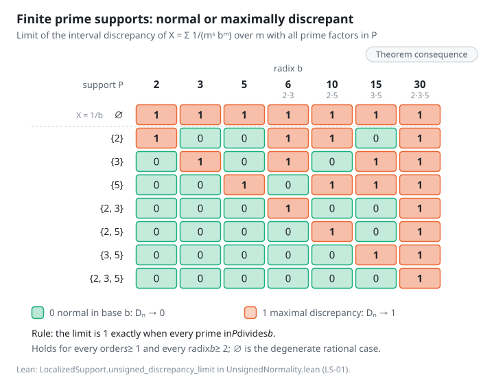
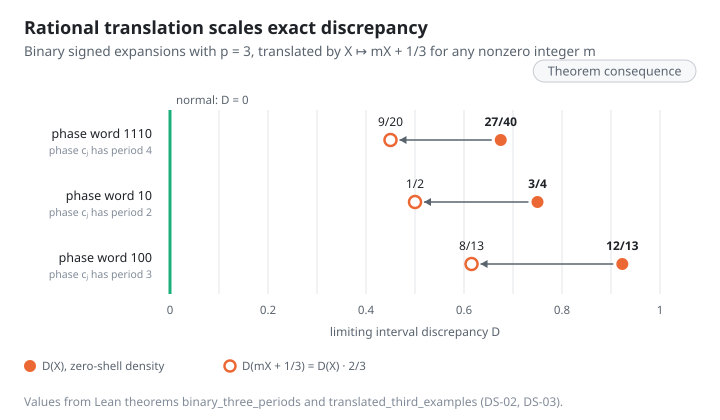

<!-- Generated by scripts/portal.py from assets/figures/figures.json. Do not edit by hand. -->

# Figures

Each figure is generated, together with its data, by a standard-library Python script. Run `python3 scripts/figures/build.py` to regenerate all of them and `--check` to verify the committed files. Every figure carries a provenance label: a *theorem consequence* shows values implied by a stated theorem, an *exact finite computation* uses rational arithmetic on a finite range, and a *numerical illustration* is a finite sample that is not evidence for any limit statement.

**Colour convention.** Aqua marks normality and uniform distribution. Orange marks resonance, concentration and exact positive discrepancy. Violet marks an arithmetic barrier. Grey hatching marks unresolved conditions. Blue is used for neutral exact data. Pages switch between light and dark variants automatically. Light-theme PDFs for manuscripts are in [assets/figures/pdf](../assets/figures/pdf).

1. [Stoneham square insertion lattice showing the pairwise products of terms](#stoneham-square-lattice)
2. [Exact denominator exponent landscape across multiple geometric scales](#stoneham-square-denominator)
3. [Finite-prime-support classification matrix across representative radices](#finite-support-classification)
4. [Signed-shell uniform and resonant regions](#signed-shell-regions)
5. [Exact discrepancy before and after rational translation](#translated-discrepancy)
6. [Finite-resolution visualization of the attainable discrepancy spectrum](#attainable-spectrum)
7. [Proof-dependency map: which common mathematical techniques support the main theorems](#proof-dependency-map)
8. [Illustrative joint distributions of digits of distinct Stoneham powers](#stoneham-joint-digits)
9. [Comparison of logarithmic denominator growth in classical-constant models](#classical-denominator-growth)

## Figure 1. Stoneham square insertion lattice showing the pairwise products of terms

<picture>
  <source media="(prefers-color-scheme: dark)" srcset="../assets/figures/stoneham-square-lattice-dark.svg">
  
</picture>

**Exact finite computation.** The *j*th term of α = α₂,₃ is inserted at binary position 3ʲ, a sparse one-dimensional sequence. Squaring turns it into a two-dimensional lattice: the ordered pair (*i*, *j*) contributes the coefficient 3⁻⁽ⁱ⁺ʲ⁾ at position 3ⁱ + 3ʲ, and (*i*, *j*) and (*j*, *i*) share a position, so off the diagonal the coefficient there is 2·3⁻⁽ⁱ⁺ʲ⁾. Blue cells are the pairs kept by the exact shifted prefix at digit *n* = 270 = 3⁵ + 3³, those with 3ⁱ + 3ʲ ≤ *n*; in the offset coordinates (5 − *i*, 5 − *j*) this is the upward-closed set *U*ₜ of the polynomial theorem (ST-01) with *t* = *n*/3⁵ = 10/9, restricted to positive indices. Its top layer *i* + *j* = 8 has three pairs, so one factor of 3 cancels and the reduced denominator is 3⁷ rather than 3⁸, as in the exact profile (ST-03). Positions, the kept set and the denominator are exact computations checked against the Lean definitions.

Results: [ST-01](results.md#st-01) · [ST-03](results.md#st-03) · Files: [light SVG](../assets/figures/stoneham-square-lattice-light.svg) · [dark SVG](../assets/figures/stoneham-square-lattice-dark.svg) · [PDF](../assets/figures/pdf/stoneham-square-lattice.pdf) · [generator](../scripts/figures/fig_square_lattice.py) · [stoneham-square-lattice.csv](../assets/figures/data/stoneham-square-lattice.csv) · [stoneham-square-lattice.json](../assets/figures/data/stoneham-square-lattice.json)

Text description

A 6 by 6 grid of cells indexed by i from 1 to 6 left to right and j from 1 to 6 bottom to top. Each cell shows the insertion position 3 to the i plus 3 to the j and the coefficient 3 to the minus (i + j); the grid is symmetric about the diagonal. Positions range from 6 in the corner (1, 1) to 1458 in the corner (6, 6). Twenty-two cells are shaded blue: all pairs with both indices at most 4, plus (5, 1), (5, 2), (5, 3) and their transposes, the pairs whose position is at most 270. Cells (4, 4), (5, 3) and (3, 5) on the anti-diagonal i + j = 8 have an orange outline. Below, a logarithmic number line from about 2 to 1600 shows the 6 insertion positions 3 to the j of alpha in one row and the 21 distinct positions of alpha squared in a second row, clustered just after each power of 3, with a vertical marker at n = 270; positions up to 270 are blue.

## Figure 2. Exact denominator exponent landscape across multiple geometric scales

<picture>
  <source media="(prefers-color-scheme: dark)" srcset="../assets/figures/stoneham-square-denominator-dark.svg">
  
</picture>

**Exact finite computation.** For every digit position 1 ≤ *n* < 3⁹ the blue step line is the exponent of 3 in the reduced denominator *q*ₙ of the shifted rational prefix *R*ₙ of α², which keeps exactly the products of terms whose insertion position 3ⁱ + 3ʲ is at most *n*. Every value is an exact rational computation (each *q*ₙ is a power of 3), checked at all 19 683 positions 0 ≤ *n* < 3⁹ against an independent recurrence and against the closed form proved in Lean: on each scale 3ᵏ ≤ *n* < 3ᵏ⁺¹ with *k* ≥ 4 the exponent is 2*k* − 2, 2*k* − 3, 2*k* − 1 and 2*k* on four intervals starting at 3ᵏ, 3ᵏ + 3ᵏ⁻², 3ᵏ + 3ᵏ⁻¹ and 2·3ᵏ. Orange marks the intervals where one factor of 3 cancels, and the small-scale exception *q*ₙ = 9 for 30 ≤ *n* < 36. The grey band is the kernel-verified bound *n*²/243 < *q*ₙ ≤ *n*² for *n* ≥ 81 (ST-03).

Results: [ST-03](results.md#st-03) · Files: [light SVG](../assets/figures/stoneham-square-denominator-light.svg) · [dark SVG](../assets/figures/stoneham-square-denominator-dark.svg) · [PDF](../assets/figures/pdf/stoneham-square-denominator.pdf) · [generator](../scripts/figures/fig_square_denominator.py) · [stoneham-square-denominator.csv](../assets/figures/data/stoneham-square-denominator.csv)

Text description

Two step charts. The upper chart has a logarithmic horizontal axis of digit position n from 1 to 19683, with vertical lines at the powers of 3, and a vertical axis from 0 to 18 giving the exponent of 3 in the reduced denominator. The blue step line starts at 0, jumps to 2 at n = 6, 3 at 12 and 4 at 18, drops to 2 on the orange interval from 30 to 35, then rises by about two per power of 3 up to 16, staying inside a grey band between the lines 2 log base 3 of n minus 5 and 2 log base 3 of n. On each scale from 81 on, a narrow orange interval marks a dip of one. The lower chart enlarges the scale from 729 to 2187 on a linear axis: the exponent is 10 from 729, drops to 9 from 810 (orange), is 11 from 972 and 12 from 1458 up to 2187.

## Figure 3. Finite-prime-support classification matrix across representative radices

<picture>
  <source media="(prefers-color-scheme: dark)" srcset="../assets/figures/finite-support-classification-dark.svg">
  
</picture>

**Theorem consequence.** Each cell gives the limit of the interval discrepancy *D*ₙ of *X* = Σ 1/(*m*ˢ *b*ᵐ), summed over the positive integers *m* whose prime factors all lie in the support *P*, in base *b*. By the kernel-verified theorem LS-01 the limit is 0, so *X* is normal in base *b*, as soon as one prime of *P* does not divide *b*; it is 1, the maximal value, when every prime of *P* divides *b*. The same matrix holds for every positive integer order *s*. The empty support is covered by the theorem and is degenerate: then *X* = 1/*b* is rational and the limit is 1. The cells are a direct consequence of the theorem, not a computation of digits.

Results: [LS-01](results.md#ls-01) · Files: [light SVG](../assets/figures/finite-support-classification-light.svg) · [dark SVG](../assets/figures/finite-support-classification-dark.svg) · [PDF](../assets/figures/pdf/finite-support-classification.pdf) · [generator](../scripts/figures/fig_support_matrix.py) · [finite-support-classification.csv](../assets/figures/data/finite-support-classification.csv)

Text description

Matrix with eight rows of prime supports (empty set, {2}, {3}, {5}, {2, 3}, {2, 5}, {3, 5}, {2, 3, 5}) and seven columns of radices (2, 3, 5, 6, 10, 15, 30). Cells labelled 0 are tinted aqua (normal); cells labelled 1 are tinted orange (maximal discrepancy). A 1 appears exactly when every prime of the support divides the radix: the whole empty-support row, the cells of {2} under radices 2, 6, 10 and 30, and the whole radix-30 column.

## Figure 4. Signed-shell uniform and resonant regions

<picture>
  <source media="(prefers-color-scheme: dark)" srcset="../assets/figures/signed-shell-regions-dark.svg">
  
</picture>

**Theorem consequence.** Binary signed Stoneham expansions with *p* = 3 and repeating phase words 1110, 10 and 100; shell *j* holds the starting positions 3ʲ ≤ *n* < 3ʲ⁺¹. Asymptotically, the orbit of 2ⁿ*X* modulo 1 is uniformly distributed on shells with nonzero phase (aqua) and concentrates near 0 modulo 1 on zero-phase shells (orange). The solid curve is the exact zero-shell fraction *Z*(*N*)/*N*, counted with integers at every drawn cutoff *N* ≤ 3¹⁰: by theorem DS-01, *D*ₙ − *Z*(*N*)/*N* → 0, so it is the discrepancy the theorem predicts, not a measurement of *D*ₙ. The dashed lines mark its limsup, the kernel-verified limiting discrepancies 27/40, 3/4 and 12/13 (DS-02).

Results: [DS-01](results.md#ds-01) · [DS-02](results.md#ds-02) · Files: [light SVG](../assets/figures/signed-shell-regions-light.svg) · [dark SVG](../assets/figures/signed-shell-regions-dark.svg) · [PDF](../assets/figures/pdf/signed-shell-regions.pdf) · [generator](../scripts/figures/fig_signed_shells.py) · [signed-shell-regions.csv](../assets/figures/data/signed-shell-regions.csv)

Text description

Three stacked panels, one per phase word 1110, 10 and 100, sharing a logarithmic horizontal axis of prefix length N from 1 to 3 to the 10th. Above each panel a band of ten equal-width shells is coloured aqua for nonzero phase and orange for zero phase: every fourth shell for 1110, every second shell for 10, and two of every three shells for 100. Below, a solid curve shows the exact fraction Z(N)/N of zero-shell positions, rising across orange shells and falling across aqua ones. Its peaks approach dashed lines at 27/40, 3/4 and 12/13 respectively.

## Figure 5. Exact discrepancy before and after rational translation

<picture>
  <source media="(prefers-color-scheme: dark)" srcset="../assets/figures/translated-discrepancy-dark.svg">
  
</picture>

**Theorem consequence.** For the binary signed Stoneham expansions with *p* = 3 and phase words 1110, 10 and 100, the limiting interval discrepancy equals the upper density of zero-phase shells: 27/40, 3/4 and 12/13. Translating by 1/3 multiplies each value by the discrepancy 2/3 of the orbit of 1/3, giving 9/20, 1/2 and 8/13 for every nonzero integer multiple *m*. All six values are kernel-verified. The translated numbers remain nonnormal; translation lowers the discrepancy without removing the resonance.

Results: [DS-02](results.md#ds-02) · [DS-03](results.md#ds-03) · Files: [light SVG](../assets/figures/translated-discrepancy-light.svg) · [dark SVG](../assets/figures/translated-discrepancy-dark.svg) · [PDF](../assets/figures/pdf/translated-discrepancy.pdf) · [generator](../scripts/figures/fig_translation.py) · [translated-discrepancy.csv](../assets/figures/data/translated-discrepancy.csv)

Text description

Dot plot on a horizontal discrepancy axis from 0 to 1. Three rows, one per phase word. In each row a filled orange dot marks the original discrepancy (27/40, 3/4, 12/13) and an open orange ring marks the translated discrepancy (9/20, 1/2, 8/13), joined by an arrow pointing left. A teal tick at zero marks normality.

## Figure 6. Finite-resolution visualization of the attainable discrepancy spectrum

<picture>
  <source media="(prefers-color-scheme: dark)" srcset="../assets/figures/attainable-spectrum-dark.svg">
  
</picture>

**Exact finite computation.** The spectrum *S*₃ is the set of limiting discrepancies *D*∞ of signed Stoneham expansions with *p* = 3 over all bounded integer phase sequences, for any radix *b* coprime to 3; theorem DS-04 identifies it with the values Σ 2*s*ᵢ/3ⁱ⁺¹ of the binary words *s*₀*s*₁*s*₂… that are lexicographically at least each of their suffixes. Row *L* draws a finite subset of *S*₃: the exact rational discrepancies of all phase sequences of period at most *L*, from the kernel-verified periodic formula. By the kernel-verified periodic approximation every point of *S*₃ lies within 1/3ᵏ of a tick in row *L* = 2*k*, so the rows converge to *S*₃, but no row is the uncountable set itself; for example the smallest positive value 2/3 and the value 8/9 are attained only by nonperiodic phases. Zero, the normal case, is an isolated point of the spectrum. The shaded gap (3/4, 8/9) is a short deduction from the characterization, not a separate Lean theorem: a dominating word beginning 10 cannot contain 11, so it is at most 1010…, of value 3/4, while a word beginning 11 has value at least 8/9.

Results: [DS-04](results.md#ds-04) · Files: [light SVG](../assets/figures/attainable-spectrum-light.svg) · [dark SVG](../assets/figures/attainable-spectrum-dark.svg) · [PDF](../assets/figures/pdf/attainable-spectrum.pdf) · [generator](../scripts/figures/fig_spectrum.py) · [attainable-spectrum.csv](../assets/figures/data/attainable-spectrum.csv)

Text description

Top strip: a horizontal axis from 0 to 1 with a single aqua tick at 0 labelled normal and isolated, an empty stretch up to 2/3, and dense blue ticks between 2/3 and 1. Connector lines enlarge the interval from 2/3 to 1 into a lower panel with seven rows of blue rug ticks for period bounds L = 2, 4, 6, 8, 10, 12 and 14, containing 3, 8, 23, 71, 226, 747 and 2538 distinct values. The ticks fill in a Cantor-like pattern; a shaded band marks the empty gap between 3/4 and 8/9. Triangles mark the kernel-verified examples 27/40, 3/4 and 12/13.

## Figure 7. Proof-dependency map: which common mathematical techniques support the main theorems

<picture>
  <source media="(prefers-color-scheme: dark)" srcset="../assets/figures/proof-dependency-map-dark.svg">
  
</picture>

**Exact finite computation.** Techniques (left) feed intermediate frameworks (centre) and the eight principal theorems (right), grouped by family: Stoneham polynomial images and joint uniformity (ST-01, ST-05), exact signed-shell discrepancy, translation and spectrum (DS-01, DS-03, DS-04), the cyclotomic classification (CR-01), and the unsigned finite-support dichotomy with its polynomial-weight extension (LS-01, MW-01). Every solid edge is verified by the figure generator against the Lean import graph: each module of the source is transitively imported by the target, and a declaration of the source is referenced along the import path. Dashed edges are historical, not logical: the order-one joint-failure formula of Phase 10 preceded the all-orders theorem, and the cyclotomic checker preceded the signed-shell analysis; the generator checks that neither is used as a dependency. The dotted edge marks Ridout's theorem, a published input used only on paper for the transcendence corollary of signed expansions (DS-07). All eight theorem modules also import the definition of normality, Weyl's criterion and the Fourier test.

Results: [ST-01](results.md#st-01) · [ST-05](results.md#st-05) · [DS-01](results.md#ds-01) · [DS-03](results.md#ds-03) · [DS-04](results.md#ds-04) · [CR-01](results.md#cr-01) · [LS-01](results.md#ls-01) · [MW-01](results.md#mw-01) · Files: [light SVG](../assets/figures/proof-dependency-map-light.svg) · [dark SVG](../assets/figures/proof-dependency-map-dark.svg) · [PDF](../assets/figures/pdf/proof-dependency-map.pdf) · [generator](../scripts/figures/fig_dependency_map.py) · [proof-dependency-map.json](../assets/figures/data/proof-dependency-map.json)

Text description

Node-link diagram in three columns. Left column, techniques: upper-orthant sums with K(p) congruent to 1 mod p minus 1; short-orbit cancellation on a fixed prime support; shell counting of signed phases; discrepancy of rational orbits; complete-orbit character sums; p-adic lift of cell coefficients; recurrence on the logarithmic circle; finite differences and finite-ray separation. Middle column, frameworks: rational-prefix normality certificate; discrepancy on selected positions; Ridout's theorem as a paper input; insertion-cell model; the order-one joint-failure formula of Phase 10 as a historical node; persistent failed regions with exact discrepancy at all orders; polynomial masks. Right column, results ST-01, ST-05, DS-01, DS-03, DS-04, CR-01, LS-01, MW-01. Solid arrows: orthant sums and the certificate to ST-01, ST-01 to ST-05; short-orbit cancellation to the certificate, certificate to selected positions, which with shell counting feeds DS-01; DS-01 to DS-03 and DS-04; rational orbits to DS-03; orbit sums and p-adic lifts to the cell model, which feeds CR-01; recurrence, finite differences and persistent regions to LS-01; LS-01 and polynomial masks to MW-01. Dashed arrows: CR-01 to DS-01 and the order-one formula to persistent regions, both historical. A dotted arrow from Ridout's theorem to DS-01. A band at the bottom states that all eight result modules import the definition of normality, Weyl's criterion and the Fourier test.

## Figure 8. Illustrative joint distributions of digits of distinct Stoneham powers

<picture>
  <source media="(prefers-color-scheme: dark)" srcset="../assets/figures/stoneham-joint-digits-dark.svg">
  
</picture>

**Numerical illustration, not evidence.** Each panel is a 16 × 16 histogram of the first four binary digits of two powers of α = α₂,₃ along the same orbit: the cell (*a*, *b*) counts the *n* < 16 384 with ⌊16{2ⁿαʳ}⌋ = *a* and ⌊16{2ⁿαˢ}⌋ = *b*, for (*r*, *s*) = (1, 2), (1, 3) and (2, 3). Shading gives the count divided by the uniform expectation 64; the observed ratios lie between 0.69 and 1.47, and the chi-square statistics on 255 degrees of freedom are 253.7, 235.2 and 243.3. The digits are exact, since α is truncated with a certified tail bound and no digit is affected by rounding, but the figure is a numerical illustration: a finite sample is not evidence about the limit. The limit statement, that for distinct positive exponents the vectors of fractional parts {2ⁿαʳ} are jointly uniformly distributed in the unit cube, is the Lean theorem ST-05.

Results: [ST-05](results.md#st-05) · Files: [light SVG](../assets/figures/stoneham-joint-digits-light.svg) · [dark SVG](../assets/figures/stoneham-joint-digits-dark.svg) · [PDF](../assets/figures/pdf/stoneham-joint-digits.pdf) · [generator](../scripts/figures/fig_joint_digits.py) · [stoneham-joint-digits.csv](../assets/figures/data/stoneham-joint-digits.csv) · [stoneham-joint-digits.json](../assets/figures/data/stoneham-joint-digits.json)

Text description

Three square heat maps side by side, titled alpha against alpha squared, alpha against alpha cubed, and alpha squared against alpha cubed. Each is a 16 by 16 grid over the unit square, horizontal axis the fractional part of 2 to the n times the first power and vertical axis that of the second. Cell darkness in a single aqua hue gives the count divided by the uniform expectation 64, in five classes from below 0.8 to 1.2 or more. The shading shows no visible structure: most cells fall between 0.9 and 1.1. Below the panels: chi-square 253.7, 235.2 and 243.3 on 255 degrees of freedom, and count ratios from 0.69 to 1.44, 0.73 to 1.47, and 0.69 to 1.33. A note states that an independent uniform sample would give chi-square about 255 plus or minus 23 and that finite counts are not evidence about the limit.

## Figure 9. Comparison of logarithmic denominator growth in classical-constant models

<picture>
  <source media="(prefers-color-scheme: dark)" srcset="../assets/figures/classical-denominator-growth-dark.svg">
  
</picture>

**Exact finite computation.** Each curve plots (log *q*(*N*))/*N*, with the natural logarithm, where *q*(*N*) is the exact reduced denominator of the shifted binary prefix at position *N*, computed with rational arithmetic up to *N* = 4096 from the Lean definitions and checked against logDen 10 = 63, the divisibility bounds and the prime-survival bands. The curves are the standard series for ln 2 (rate 1, CC-03), the half-rate series 2Σ 1/(*j*·4ʲ) + Σ (−1)ʲ⁺¹/(*j*·8ʲ) for ln 2 (rate 1/2, CC-01), the dyadic logarithms ln(4/3) and ln(8/7) (rates 1/2 and 1/3, CC-06), and a Gaussian model for arctan(1/2) whose rate 2/3 is a paper deduction only (CC-12). The violet region is the range log *q* ≤ *d* log *N*, drawn for *d* = 3, that the rational-prefix certificate (AC-01) allows, in addition to prime factors from a fixed finite set. Exponential growth and unbounded prime support place these classical models outside the certificate's hypotheses; this says nothing about whether ln 2 is normal, and the discrepancy bound 0.9999 for ln 2 remains open.

Results: [CC-01](results.md#cc-01) · [CC-03](results.md#cc-03) · [CC-06](results.md#cc-06) · [CC-12](results.md#cc-12) · [AC-01](results.md#ac-01) · Files: [light SVG](../assets/figures/classical-denominator-growth-light.svg) · [dark SVG](../assets/figures/classical-denominator-growth-dark.svg) · [PDF](../assets/figures/pdf/classical-denominator-growth.pdf) · [generator](../scripts/figures/fig_classical_denominators.py) · [classical-denominator-growth.csv](../assets/figures/data/classical-denominator-growth.csv)

Text description

Line chart. Horizontal axis: position N on a logarithmic scale from 32 to 4096. Vertical axis: log of the reduced denominator divided by N, from 0 to 1.1. Thin dotted reference lines mark the theorem rates 1, 2/3, 1/2 and 1/3. A solid grey curve for the standard ln 2 series fluctuates between about 0.8 and 1 and settles near 0.99, near rate 1. A dash-dot curve for arctan(1/2), marked paper-only, settles near 2/3. A dashed curve for the half-rate ln 2 series and open circles for ln(4/3) nearly coincide and approach 1/2. A dotted curve for ln(8/7) approaches 1/3. A violet shaded region along the bottom, bounded by 3 log N / N, shrinks toward zero and marks the denominators allowed by the rational-prefix certificate.

