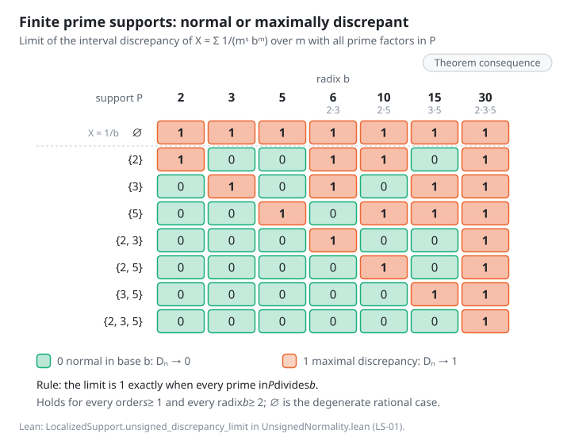
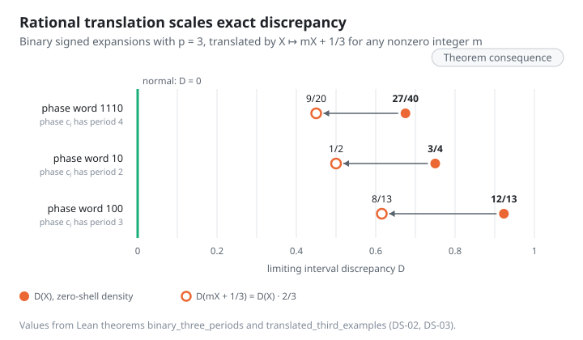
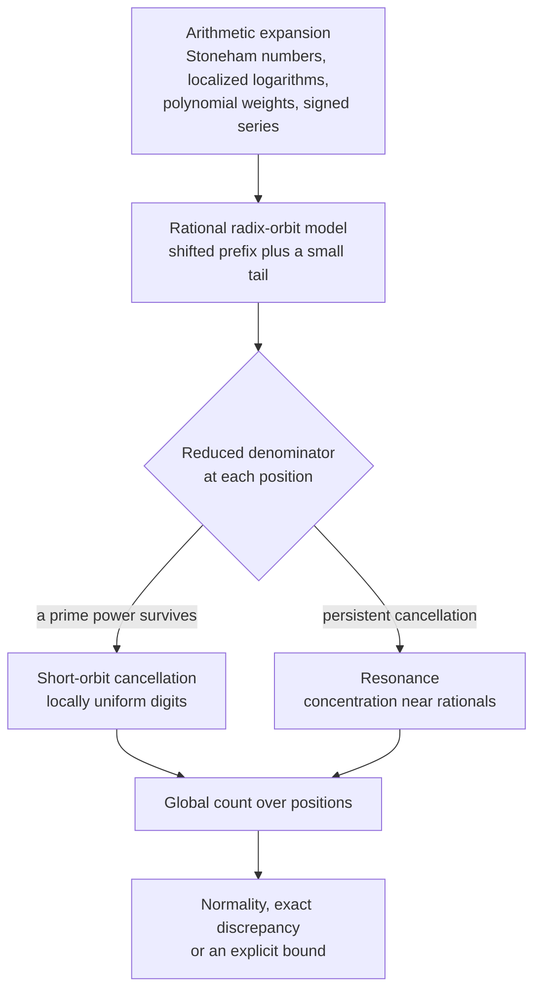

# Detailed survey of results

This page keeps the full survey that was the front page of the repository until the release candidate `manuscripts-v2.0.0`: the notation for discrepancy, the statements of the principal theorems with their figures, the complete classical-constant matrix, and the survey of every result family with proof links. Nothing was removed; the [README](../README.md) now leads with a short selection of results and links here for the rest. Every result has a permanent identifier in the [curated result index](results.md). The prose below describes the research as of the Phase 19 checkpoint and still uses its internal phase names.

[Distribution terminology](#distribution-terminology) · [Principal theorems](#principal-theorems) · [How the results fit together](#how-the-results-fit-together) · [Classical targets status](#classical-targets-status) · [Results by topic](#results-by-topic) · [Open problems](#open-problems-and-limitations) · [Manuscripts](../README.md#research-papers) · [Research history](history.md)

## Distribution terminology

For a real number *x* and integer radix *b* ≥ 2, write *D*<sub>*N*</sub>(*x*; *b*) for the extreme interval discrepancy of the first *N* fractional parts {*b*ⁿ*x*} (0 ≤ *n* < *N*): the supremum over half-open intervals [*u*, *v*) ⊆ [0, 1) of the absolute difference between the empirical visit frequency and *v* − *u*. Define the lower and upper asymptotic discrepancies

```math
D^-(x; b) = \liminf_{N \to \infty} D_N(x; b), \qquad D^+(x; b) = \limsup_{N \to \infty} D_N(x; b)
```

(written *D*∞(*x*) in earlier notes and registry statements). Distinct distribution notions are strictly separated throughout the repository:

| Property | Definition / meaning | Relation to normality |
| --- | --- | --- |
| **Full normality** (base *b*) | *D*⁺(*x*; *b*) = 0; every *k*-digit word has limiting frequency 1/*b*ᵏ | Strongest property here |
| **Simple normality** (base *b*) | Every single digit 0, …, *b* − 1 has limiting frequency 1/*b* | Necessary, not sufficient for full normality |
| **Disjunctivity** | Every finite word occurs at least once (equivalently infinitely often) | Compatible with *D*⁺ = 1 and one-digit density 0 (e.g., *L*<sub>χ₄</sub>, [CC-48](results.md#cc-48)) |
| **Positive lower word density** | Every word *w* occurs at least *c*<sub>*w*</sub> *N* times along late prefixes/windows | Strictly weaker than normality; compatible with non-normality |
| **Logarithmic equidistribution** | Frequencies weighted by 1/(*n* + 1) converge to Lebesgue measure | Implies *D*⁻ = 0, but compatible with *D*⁺ = 1 (Pair B, [AC-11](results.md#ac-11)) or *D*⁺ > 0 |
| **Positive uniform coverage** | A positive share *g* of positions is certified locally uniform | Implies *D*⁺ ≤ 1 − *g*(1 − *d*) ([AC-02](results.md#ac-02)); finite initial segments do not count |
| **Upper discrepancy bound** | *D*⁺(*x*; *b*) ≤ *c* < 1 for an explicit constant *c* | Rules out maximal discrepancy 1; **never** a "percentage of normality" |

## Principal theorems

### I. Polynomial images of Stoneham numbers

**Theorem I.** Let *b* ≥ 2 and *c* > 2 be coprime integers. Define the Stoneham number

```math
\alpha = \sum_{j=1}^{\infty} \frac{1}{c^j \, b^{c^j}}.
```

For every polynomial *P* with rational coefficients and positive degree, *P*(α) is normal in base *b*. This means that each word of *h* digits has limiting frequency 1/*b*ʰ. Moreover, if *r*₁, …, *r*ₖ are distinct positive integers, the points

```math
\left( \{ b^n \alpha^{r_1} \}, \ \ldots, \ \{ b^n \alpha^{r_k} \} \right), \qquad n = 0, 1, 2, \ldots
```

are uniformly distributed in the unit cube [0, 1)ᵏ.

For *b* = 2 and *c* = 3, the classical Stoneham square is normal in every power-of-two base. In base 48 even its zero digit occurs too often for simple normality. For general *c* > 2, coincident insertions are controlled by reflecting the exponents and summing on the resulting upper set. The local units may cycle when *c* is composite. Nonvanishing of the weighted sum bounds cancellation in the reduced prefix denominator.

[Lean polynomial theorem](../NormalityChecker/PeriodicPolynomialNormal.lean#L145) · [Joint frequencies](../NormalityChecker/PeriodicPolynomialNormal.lean#L170) · [Proof and hypotheses](../notes/phase13/composite-polynomials.md) · [ST-11](results.md#st-11) · [Base 48](../notes/phase13/alternate-bases.md) · [Paper I, odd prime-power case](../papers/01-stoneham-polynomials)

At parameter *c* = 2 and odd radix *b* ≥ 3, every rational quadratic has logarithmic equidistribution, *D*⁻ = 0 and *D*⁺ ≤ 1/4, with an explicit integer recurrence *Z*<sub>*k*</sub> in Lean governing *X*² − 2*X*, exact plateau-cycle formulas for *D* = 1 (*D*⁺ = 2<sup>−2−[*H*−*s*]<sub>+</sub></sup> when *b* ≡ 1 mod 4) and unconditional sub-quarter bounds such as *D*⁺((α² − 2α + *C*₀)/3) ≤ (1 − 1/(3 · 2<sup>*v*₂(*b*+1)</sup>))/4 for *b* ≡ 2 (mod 3), *C*₀ ≢ 1 (mod 3), and 5/72 for (*b*, *D*) = (5, 9). For higher degrees, the exact least orbit order *F*(*d*) = Σ<sub>*k*≤*d*</sub> ⌊log₂ *k*⌋ and nonvanishing of *M*<sub>*d*</sub> on *J*<sub>*d*</sub> are proved for all *d* ≥ 2; full polynomial normality is proved for degrees 3 through 120, degree 128, every odd prime power, and sixteen infinite cyclic-descent families *e p*ʳ (including five even families 4 · *p*ʳ and 5 · 524287ʳ), with echelon-degree joint normality and the 57-vector (3, 31) closed-orbit certificate kernel-checked in Lean. [Quadratic criterion](../notes/phase14/quadratic-orbits.md) · [Phase 17 dyadic Stoneham classification](../notes/phase17/dyadic-stoneham-classification.md) · [ST-30](results.md#st-30) · [ST-33](results.md#st-33) · [ST-34](results.md#st-34) · [Phase 17 checkpoint](../notes/phase17/README.md)

<!-- BEGIN FIGURE stoneham-square-lattice -->
<p align="center">
<picture>
  <source media="(prefers-color-scheme: dark)" srcset="../assets/figures/stoneham-square-lattice-dark.svg">
  
</picture>
</p>

<sub>Figure 1. At digit 270 the retained pairs form a lower set in the displayed exponents (*i*, *j*). Reflecting the coordinates to (5 − *i*, 5 − *j*) gives the upper set used in ST-01, restricted to the displayed indices. [Caption, data and generator](../docs/figures.md#stoneham-square-lattice)</sub>
<!-- END FIGURE stoneham-square-lattice -->

### II. Complete classification on finite prime supports

For the first *N* fractional parts {*b*ⁿ*x*}, 0 ≤ *n* < *N*, write *D*<sub>*N*</sub>(*x*) for the supremum over half-open intervals in [0, 1) of the absolute difference between the observed frequency and the interval length. Write *D*∞(*x*) for its limit superior.

**Theorem II.** Let *b* ≥ 2 and *s* ≥ 1 be integers and let *P* be a finite set of primes. Let *S* consist of 1 and all larger integers whose prime factors lie in *P*, and put

```math
X = \sum_{m \in S} \frac{1}{m^s \, b^m}.
```

If some prime in *P* does not divide *b*, then *D*<sub>*N*</sub>(*X*) tends to 0 and *X* is normal in base *b*. If every prime in *P* divides *b*, then *D*<sub>*N*</sub>(*X*) tends to 1.

For a nonzero polynomial *Q* with rational coefficients, replace the numerator 1 by *Q*(*m*). The resulting sum is normal in base *b* exactly when *Q* vanishes at 0 to order less than *s* and some prime of *P* does not divide *b*.

These are restricted logarithms (*s* = 1) and polylogarithms (*s* ≥ 2). The zero-or-one discrepancy limit applies to the unsigned series on the full support, with numerator 1. Rational polynomial weights can give intermediate limits even on the full support. The proof identifies the limiting discrepancy with the measure of a persistent cancellation region, then shows that region is null by recurrence on a logarithmic circle, multiplicative finite differences and *p*-adic separation of finitely many geometric rays. Taking *P* to be all primes gives ln 2 when *b* = 2 and *s* = 1; these finite-support theorems say nothing about that case.

[LS-01](results.md#ls-01) · [MW-01](results.md#mw-01) · [Lean dichotomy](../NormalityChecker/UnsignedNormality.lean#L194) · [Lean polynomial weights](../NormalityChecker/FullPolynomialNormality.lean#L15) · [Proof](../notes/unsigned-finite-support.md) · [Polynomial weights](../notes/polynomial-masks.md) · Paper [II](../papers/02-localized-normality) · Foundations: [exact persistent discrepancy](results.md#ls-02), [nullity of persistent regions](results.md#ls-03)

<!-- BEGIN FIGURE finite-support-classification -->
<p align="center">
<picture>
  <source media="(prefers-color-scheme: dark)" srcset="../assets/figures/finite-support-classification-dark.svg">
  
</picture>
</p>

<sub>Figure 3. Normal or maximally discrepant: the limit of the interval discrepancy for each prime support and radix, as given by LS-01 for every order *s*. [Caption, data and generator](../docs/figures.md#finite-support-classification)</sub>
<!-- END FIGURE finite-support-classification -->

### III. Exact discrepancy and resonance

**Theorem III.** Let *b* ≥ 2, let *p* be a prime not dividing *b*, and let *c*₀, *c*₁, … be a bounded sequence of integers. Put *a*₀ = *c*₀ and *a*ⱼ = *c*ⱼ − *p* *c*ⱼ₋₁ for *j* ≥ 1, and

```math
X = \sum_{j=0}^{\infty} \frac{a_j}{p^j \, b^{p^j}}.
```

Call the positions *p*ʲ ≤ *n* < *p*ʲ⁺¹ shell *j*, and let *Z*(*N*) count the positions *n* < *N* in shells with *c*ⱼ = 0. Then

1. *D*<sub>*N*</sub>(*X*) − *Z*(*N*)/*N* tends to 0, so *D*∞(*X*) is the upper density of positions in zero-phase shells.
2. for every nonzero integer *m* and rational *r*, *D*∞(*mX* + *r*) = *D*∞(*X*) · *D*(*r*), where *D*(*r*) is the interval discrepancy of the eventual periodic orbit of *r*.
3. the attainable values of *D*∞(*X*) are exactly the numbers

```math
V_p(s) = (p-1) \sum_{i=0}^{\infty} \frac{s_i}{p^{i+1}}
```

for binary sequences *s* that are lexicographically at least each of their own suffixes. This set does not depend on *b*.

On late nonzero shells the shifted points approach uniform distribution. On late zero shells their distances to integers tend to zero. The theorem therefore computes discrepancy exactly instead of bounding it. In base 2 with *p* = 3, the periodic phase words 1110, 10 and 100 give 27/40, 3/4 and 12/13. Translating by 1/3 multiplies these by 2/3, giving 9/20, 1/2 and 8/13. A cyclotomic test, also verified, decides normality of every finite rational combination of Stoneham-type components with an odd prime parameter, and produces nonnormal sums of normal numbers in every radix.

[DS-01](results.md#ds-01) · [DS-03](results.md#ds-03) · [DS-04](results.md#ds-04) · [CR-01](results.md#cr-01) · [Lean shell theorem](../NormalityChecker/SignedShellDiscrepancy.lean#L144) · [Lean translation](../NormalityChecker/TranslatedShells.lean#L221) · [Lean spectrum](../NormalityChecker/ShellHistories.lean#L388) · [Proof](../notes/signed-shell-discrepancy.md) · [Translations](../notes/translated-shells.md) · [Spectrum](../notes/attainable-shell-histories.md) · Paper [III](../papers/03-signed-resonance)

<!-- BEGIN FIGURE translated-discrepancy -->
<p align="center">
<picture>
  <source media="(prefers-color-scheme: dark)" srcset="../assets/figures/translated-discrepancy-dark.svg">
  
</picture>
</p>

<sub>Figure 5. Translation by 1/3 multiplies each exact discrepancy by 2/3, the discrepancy of the orbit of 1/3 (DS-03). [Caption, data and generator](../docs/figures.md#translated-discrepancy)</sub>
<!-- END FIGURE translated-discrepancy -->

### IV. Designing the distribution through rational insertions

A positive rational expansion at cubic positions realizes every ordinary discrepancy limit between zero and one, with error of order 1/∛*N*. Changing the schedule gives Liouville numbers with any of the same limits. For translations, the worst possible change of finite discrepancy over all starting numbers equals one minus the discrepancy of the added number. [Programmable limits](../notes/phase18/programming.md) · [Liouville realizations](../notes/phase18/liouville-realization.md) · [Sharp translation theorem](../notes/phase18/translations.md#the-exact-worst-case-change)

On factorial insertion schedules the normal examples are Liouville numbers, and every nonconstant rational polynomial in one of them is normal in the same base. For insertions at *t k*ᵈ, let *p* be the retained odd prime, *t* the order of the radix modulo *p*, and *s* the positive power to which the *p*-part of *k* is raised in its coefficient denominator. The first min(*s*, *d* − 1) powers of this number are jointly normal. [Polynomial and product theorems](../notes/phase18/algebra.md)

One positive sum over infinitely many denominator primes is binary normal. Other positive sums can have any prescribed rational total even when every finite collection of their components is jointly uniform. Geometric partitions of the Taylor and BBP series give such finite joint uniformity for components of ln 2 and π. Their full orbit distributions remain open. [Infinite-sum proofs](../notes/phase18/summation.md) · [Taylor grouping delay](../notes/phase18/prime-delay.md) · [Phase 18 research and verification](../notes/phase18/README.md)

Phase 17’s rounding of an entire Legendre integral also works for π at every sufficiently large binary shift. At shift 600 the Machin construction gives a 257-bit odd denominator and at least 261 bits of absolute accuracy. The orbit of the resulting rational throughout that window still requires a distribution estimate. [All-shift theorem and exact checks](../notes/phase18/phase17-transfer.md)

### V. Arithmetic operations and all-prime support

**The addition spectrum.** Fix an integer radix *b* ≥ 2. Let *D*<sub>*N*</sub>(*x*) be the supremum over half-open intervals of the absolute difference between interval length and visit frequency among the first *N* fractional parts of *b*ᵏ*x*, starting at *k* = 0. Three numbers α, β, γ in [0, 1] occur as the respective limits for *x*, *y*, and *x* + *y* exactly when

```math
\max(0,\alpha+\beta-1)\le\gamma\le 1-|\alpha-\beta|.
```

Positive rational coefficients at cubic insertion positions realize every permitted triple. At each prefix the error in all three coordinates is at most a constant times 1/∛*N*, uniformly in the target triple for fixed radix and retained prime. [Exact spectrum in Lean](../NormalityChecker/AdditionSpectrum.lean#L1486) · [Proof, quantitative realization and examples](../notes/phase19/addition.md)

The binary cubic example above and its square are jointly normal. The proof isolates jumps in the limiting 3-adic numerator and shows that every level set has real measure zero. This replaces the earlier small upper discrepancy bound for the square. A separate construction keeps different denominator primes on different generators and makes every nonconstant rational polynomial in those generators normal. [Quadratic proof](../notes/phase19/nonlinear.md) · [Independent-prime construction](../notes/phase19/independent-axes.md)

A positive binary series retaining every odd prime is normal and Liouville, with discrepancy of order at most 1/log *N*. One distinguished prime produces equally spaced residues even in the presence of all the others. For the actual Taylor prefixes of ln 2, the order of 2 modulo the surviving large primes grows faster than every polynomial in the cutoff. [All-prime theorem](../notes/phase19/grids.md) · [Taylor-period obstruction](../notes/phase19/taylor-periods.md)

The finite translation deficit gives a pseudometric. Its zero differences at two or more shifts are exactly the radix fixed points. The rational scalars preserving its asymptotic kernel for every input are precisely those with denominator dividing a power of the radix. Among the individual deterministic Taylor rows of ln 2, odd part 3 has discrepancy limit 2/3, while odd part 5 has lower limit 1/5 and upper limit 8/15. [Lean geometry](../NormalityChecker/DiscrepancyGeometry.lean) · [Operations and proofs](../notes/phase19/geometry.md) · [Taylor rows](../notes/phase19/logarithm-rays.md) · [Phase 19 results](../notes/phase19/README.md)

### VI. Arithmetic generating functions and coefficient transfer

**Sparse linear-mass coefficient transfer.** Fix an integer radix *b* ≥ 2 and an integer sequence *a*(*m*) with cumulative mass *A*(*X*) = Σ<sub>*m* ≤ *X*</sub> |*a*(*m*)| and support count *S*(*X*). Whenever *A*(*X*) = *O*(*X*) and *S*(*X*) = *o*(*X*), the value *F*<sub>*b*</sub>(*a*) = Σ<sub>*m* ≥ 1</sub> *a*(*m*)*b*<sup>−*m*</sup> satisfies *D*<sub>*N*</sub>(*F*<sub>*b*</sub>(*a*); *b*) → 1 and preserves every input's discrepancy under translation. Lean verifies this transfer, composite-radix displaced factorization *a*(*m*) = *b*<sup>*V*</sup>*U*, and a two-sided circle separation lemma. On paper, the linear-mass rate has sharp leading constant 2, displaced widths lower the constant to 1 under bounded mean |*U*|, isolated sources satisfy an exact leading law (giving 1 − *D*<sub>*N*</sub>(Σ<sub>*p*</sub> *b*<sup>−*p*</sup>; *b*) ∼ (log log *N*)/(log *b* · log *N*) for the prime constant), and width-density-one counterexamples show that *S*(*X*) = *o*(*X*) alone is insufficient. [Lean coefficient transfer](../NormalityChecker/CoefficientTransfer.lean) · [Coefficient transfer proofs](../notes/phase20/coefficient-transfer.md) · [GF-01](results.md#gf-01) · [GF-02](results.md#gf-02)

**Euler's product, powers, theta values and weight-one modular forms.** In every base *b* ≥ 2, Euler's pentagonal value *E*<sub>*b*</sub> = ∏<sub>*k* ≥ 1</sub> (1 − *b*<sup>−*k*</sup>) and its cube *E*<sub>*b*</sub><sup>3</sup> lie in *K*<sub>*b*</sub> (kernel-verified in Lean), with exact base-*b* digit expansions, word frequencies 1/2 for 0<sup>*L*</sup> and (*b* − 1)<sup>*L*</sup>, and sharp discrepancy gaps √(2/3) (log<sub>*b*</sub> *N*)/√*N* + *O*<sub>*b*</sub>(1/√*N*) for *E*<sub>*b*</sub> (never disjunctive) and √2 (log<sub>*b*</sub> *N*)/√*N* + *O*<sub>*b*</sub>(1/√*N*) for *E*<sub>*b*</sub><sup>3</sup> (disjunctive). The square *E*<sub>*b*</sub><sup>2</sup> corresponds to the weight-one Klein-four CM eigenform η(12τ)<sup>2</sup>, giving 1 − *D*<sub>*N*</sub>(*E*<sub>*b*</sub><sup>2</sup>; *b*) ≍ (log log *N*)/(log *N*)<sup>3/4</sup>. Every binary quadratic-form theta value Θ<sub>*Q*</sub>(1/*b*) and every integer-coefficient holomorphic weight-one modular form *f*(1/*b*) lies in *K*<sub>*b*</sub>, whereas Serre's lacunary even η-powers η<sup>*r*</sup> (*r* ≥ 4) hit a structural digit-overlap obstruction. [Lean Euler pentagonal and cube](../NormalityChecker/EulerPentagonal.lean) · [Euler product and powers](../notes/phase20/euler-product.md) · [Theta values and weight-one forms](../notes/phase20/theta-and-modular.md) · [GF-03](results.md#gf-03) · [GF-04](results.md#gf-04) · [GF-06](results.md#gf-06)

**Exact Lambert leading constant, residue-class transfers and dense obstructions.** In base 2, the multiplicative Lambert series *L*<sub>χ₄</sub> and Θ<sub>3</sub>(1/2)<sup>2</sup> = 1 + 4 *L*<sub>χ₄</sub> satisfy

```math
1 - D_N(L_{\chi_4}; 2) \sim \frac{K}{2 \log 2} \, \frac{\log \log N}{\sqrt{\log N}},
```

with *K* ≈ 0.76422365 the Landau–Ramanujan constant (and analogously *C*<sub>χ</sub>/(2 log 2) for every real nonprincipal Dirichlet character χ), upgrading Phase 17's order result to an exact constant. Exact character identities modulo 8 (kernel-verified in Lean) and for general 2-elementary quotients equate the binary discrepancy asymptotics of the residue-class Lambert sums *A*<sub>1</sub>, *A*<sub>3</sub>, *A*<sub>5</sub>, *A*<sub>7</sub> and *E*<sub>odd</sub>, while deciding none of them individually. For dense series, carry-window transfer and congruence wash-out clarify why partition congruences do not determine the base-*b* digits of *P*<sub>*b*</sub> = 1/*E*<sub>*b*</sub>; *K*<sub>*b*</sub> is not closed under squaring or inversion, and chronological prefixes of the logarithmic Euler-product formula for ln 2 collapse to ordinary Taylor prefixes. Distributional behavior remains completely open for *P*<sub>*b*</sub>, Θ<sub>3</sub>(1/*b*)<sup>3</sup>, Θ<sub>3</sub>(1/*b*)<sup>4</sup>, *E*<sub>2,4,6</sub>(1/*b*), *E*<sub>*b*</sub><sup>4</sup>, and the classical constants ln 2, π, *e*, √2, φ and *E*. [Leading constant proof](../notes/phase20/lambert-leading-constant.md) · [Lean character transfer](../NormalityChecker/CharacterLambertTransfer.lean) · [Dense series and partitions](../notes/phase20/dense-and-partitions.md) · [Classical transfers](../notes/phase20/classical-transfers.md) · [GF-05](results.md#gf-05) · [GF-07](results.md#gf-07) · [GF-08](results.md#gf-08) · [GF-09](results.md#gf-09)

**All-prime polynomial normality and higher-degree power schedules.** The protected-pole series *W* = Σ<sub>*k* ≥ 1</sub> 1/(*p*<sup>*k*²</sup> ℓ<sub>*k*</sub> *b*<sup>2<sup>*k*³</sup></sup>) retains every prime coprime to *b* in its shifted prefix denominators and makes every nonconstant rational polynomial *P*(*W*) normal and Liouville with explicit super-logarithmic discrepancy rate exp(−*c*(log *N*)<sup>2/3</sup>) (truncated-polynomial pole survival kernel-verified in [`ProtectedPole.lean`](../NormalityChecker/ProtectedPole.lean)). Phase 21 pushes all-prime polynomial normality down to `exp(k (log log k)^2)` (degree 1), `exp((r - 1 + ε) k log k)` (degree ≤ *r*), polynomial schedules *t k*<sup>*d*</sup> with sparse auxiliary indices *p* ∤ *k*<sub>*j*</sub> (*d* > *r*(*s* + 1), explicit rate (log log *N*)<sup>−*d*/(*d*−1)</sup>), and all-degree quasi-polynomial schedules log *n*<sub>*i*</sub> ∼ (log *i*)<sup>2</sup> with *n*<sub>*i*+1</sub>/*n*<sub>*i*</sub> → 1 (non-Liouville status open; [GF-15](results.md#gf-15)). On power schedules *t k*<sup>*d*</sup>, every nonconstant rational polynomial of degree *r* < *d* in *C*(*b*, *p*, *s*, *d*) — and, more generally, every nonconstant multivariate polynomial of total degree *r* < *d* in distinct orders *C*(*b*, *p*, *s*<sub>*a*</sub>, *d*) — is normal in base *b* ([GF-11](results.md#gf-11), [GF-14](results.md#gf-14)); uniform multiscale isolation fails near lower-order sums, but averaged isolation gives the explicit rate *D*<sub>*N*</sub>(*P*(*C*); *b*) ≪<sub>*P*</sub> (log log *N*)<sup>−*d*/(*d*−1)</sup> for *d* > *r*(*s* + 1), while at the boundary *d* = *r* the *p*-adic depth defect is tight in density yet denominator-only data provably cannot control short-run digits (finite algebraic/combinatorial peeling, Φ<sub>*q*</sub> nonvanishing, and truncated-mass jump kernel-verified in [`PowerSumPeeling.lean`](../NormalityChecker/PowerSumPeeling.lean)). [All-prime polynomial normality](../notes/phase20/all-prime-polynomials.md) · [Higher-degree power schedules](../notes/phase20/cubic-power-schedule.md) · [Nonlinear boundary and effective rates](../notes/phase21/nonlinear-boundary.md) · [Multivariate and denser all-prime schedules](../notes/phase21/multivariate-and-dense-allprime.md) · [GF-10](results.md#gf-10) · [GF-11](results.md#gf-11) · [GF-14](results.md#gf-14) · [GF-15](results.md#gf-15)

**Phase 21 radix dependence, character transfers, rational scalings, normal reciprocals and structural walls.** Across all radices *b* ≥ 2, a sub-threshold width law (finite core in [`RadixWidthLaw.lean`](../NormalityChecker/RadixWidthLaw.lean)) proves sharp radix-2<sup>*k*</sup> discontinuities for *L*<sub>χ</sub>(*b*) (*C*<sub>χ</sub>/(2 log *b*) vs *C*<sub>χ</sub>(1 + log 2)/(2 log *b*)), Euler's square *E*<sub>*b*</sub><sup>2</sup> (3*C*<sub>η</sub>/(4 log *b*) vs *C*<sub>η</sub>(3 + log 2)/(4 log *b*), *C*<sub>η</sub> ≈ 2.41853), and binary quadratic forms Θ<sub>*Q*</sub>(1/*b*) (full lower bound, *h*<sub>0</sub> = 1 in all radices, and class group ℤ/3 in radices 2<sup>*k*</sup>; [GF-12](results.md#gf-12)). Polynomial-mass (*S*(*X*) = *o*(*X*/log *X*)) and logarithmic-mass (*S*(*X*) = *o*(*X*/log log *X*)) sparse transfers (kernel-verified in [`GeneralMassTransfer.lean`](../NormalityChecker/GeneralMassTransfer.lean)) place even-order character Lambert series, odd *M*-periodic antisymmetric transfers ([`AntisymmetricLambert.lean`](../NormalityChecker/AntisymmetricLambert.lean)), normalized *q*-digamma reflections (ψ<sub>*q*</sub>(*r*/*M*) − ψ<sub>*q*</sub>((*M* − *r*)/*M*))/log *q* at *q* = *b*<sup>−*M*</sup>, and every logarithmic derivative (*q* d/d*q*)<sup>*j*</sup> of *E*<sub>*b*</sub>, *E*<sub>*b*</sub><sup>3</sup>, Θ<sub>3</sub>(1/*b*), and *E*<sub>*b*</sub><sup>2</sup> · *DE*<sub>*b*</sub> ([`DerivativeTransfer.lean`](../NormalityChecker/DerivativeTransfer.lean)) into *K*<sub>*b*</sub> ([GF-13](results.md#gf-13), [GF-17](results.md#gf-17)). For rational scalings, finite automata ([`NormalReciprocalCore.lean`](../NormalityChecker/NormalReciprocalCore.lean)) give exact non-oscillating rational limits *D*<sub>∞</sub> ∈ [1/*d*, 1) with error *O*((log *N*)/√*N*) for (*a*/*d*)*E*<sub>*b*</sub> and (*a*/*d*)*E*<sub>*b*</sub><sup>3</sup>, while *D*<sub>*N*</sub>((*a*/2)*E*<sub>*b*</sub><sup>2</sup>; *b*) → 2/3 unconditionally for odd *b*; conversely, reciprocation can map *K*<sub>*b*</sub> onto normal numbers — explicit irrational *x* = ∏(1 − *b*<sup>−*m*<sub>*k*</sub></sup>) ∈ *K*<sub>*b*</sub> have base-*b* normal reciprocal 1/*x*, with a sharp sign dichotomy ([GF-16](results.md#gf-16)). On the obstruction side, the pentagonal recurrence and rational approximants 1/*E*<sub>*b*</sub><sup>(*K*)</sup> cannot decide *P*<sub>*b*</sub>, weight ≥ 2 CM newforms (η<sup>4</sup>, η<sup>6</sup>, η<sup>8</sup>) hit a structural width–density wall *W*<sub>*U*</sub>(*N*) ≍ *N* √(log *N*) even though *W*(*N*) = *o*(*N*) is not necessary for *K*<sub>*b*</sub> ([GF-17](results.md#gf-17)), and complementary-coverage plus strict radix-power kernel inclusion *K*<sub>*b*</sub> ⊊ *K*<sub>*b*<sup>*k*</sup></sub> (*k* ≥ 2; forward inclusion in [`ClassicalBarriers.lean`](../NormalityChecker/ClassicalBarriers.lean)) map the classical barriers for *E*, ln 2, π, *e*, √2, φ and *L*(1, χ) ([GF-18](results.md#gf-18)). [Phase 21 overview and verification](../notes/phase21/README.md)

**Phase 22 digit-frequency classification, general class groups, short-orbit rates and non-Liouville normality.** Building three new kernel-verified Lean 4 modules ([`SimpleNormalityKernel.lean`](../NormalityChecker/SimpleNormalityKernel.lean), [`RadixPowerTower.lean`](../NormalityChecker/RadixPowerTower.lean), [`Phase22Cores.lean`](../NormalityChecker/Phase22Cores.lean)), Phase 22 classifies digit frequencies across *K*<sub>*b*</sub> and its arithmetic operations: (1) a kernel-verified finite digit dichotomy proves no element of *K*<sub>*b*</sub> (*b* ≥ 3) is simply normal, no element of *K*<sub>2</sub> is 2-normal, and every nonnegative sparse series has *f*<sub>0<sup>*L*</sup></sub> → 1 (covering Θ<sub>*Q*</sub>(1/*b*), *D*<sup>*j*</sup>Θ<sub>3</sub>(1/*b*) and real *L*<sub>χ</sub>(*b*)), while exact oriented-tail transfer classifies *D*<sup>*j*</sup>*E*<sub>*b*</sub>, *D*<sup>*j*</sup>*E*<sub>*b*</sub><sup>3</sup>, *E*<sub>*b*</sub><sup>2</sup> · *DE*<sub>*b*</sub>, *q*-digamma bias (τ<sub>1,*M*</sub> − τ<sub>*M*−1,*M*</sub> ≥ 0 iff *M* ∣ 24), the non-congruence sign rule of *E*<sub>*b*</sub><sup>2</sup> (with positive lower frequency for both 0<sup>*L*</sup> and (*b* − 1)<sup>*L*</sup> via a self-contained uniform Selberg sieve), and signed rational-scaling automata showing (*a*/*d*)*E*<sub>2</sub> and (*a*/*d*)*E*<sub>2</sub><sup>3</sup> are base-2 simply normal whenever ord<sub>*d*</sub>(2) is odd ([GF-19](results.md#gf-19), [GF-20](results.md#gf-20), [GF-27](results.md#gf-27)); (2) even-composite radices exhibit explicit width-law threshold jumps δ*<sub>*b*</sub> = β<sub>*b*</sub>/(β<sub>*b*</sub> + log 2), a *p*-adic Strassmann engine determines the exact radix-2<sup>*k*</sup> leading discrepancy constant for **every** fundamental discriminant Δ < 0 and proves Phase 21's (*V*<sub>*q*</sub>) unconditionally for all *b* ≠ 2<sup>*k*</sup> ([GF-21](results.md#gf-21)); (3) universal character-Lambert disjunctivity proves *F*<sub>*b*</sub>(Φ ∘ (1 ∗ χ)) is base-*b* disjunctive and irrational for every nonprincipal χ and every radix *b* ≥ 2 (including odd-order cubic *L*<sub>±</sub>(*b*) mod 7; [GF-22](results.md#gf-22)), and the radix-power tower satisfies *M*<sub>*b*</sub> = *M*<sub>*b*<sup>*k*</sup></sub>, *K*<sub>*b*<sup>*k*</sup></sub>/*K*<sub>*b*</sub> ≅ ℤ/((*b*<sup>*k*</sup> − 1)/(*b* − 1))ℤ, with *K*<sub>*b*<sup>*k*</sup></sub> \ *K*<sub>*b*</sub> containing a base-*b* simply normal number iff *b* ∣ *k* ([GF-23](results.md#gf-23)); (4) uniform short-orbit cancellation closes the entire effective-rate gap *r* + 1 ≤ *d* ≤ *r*(*s* + 1) to *D*<sub>*N*</sub> ≪ (log log *N*)<sup>−*d*/(*d* − 1)</sup> for all *d* ≥ *r* + 1 on both *P*(*C*) and all-prime *P*(*W*<sub>*H*</sub>), while explicit non-Liouville all-prime constructions achieve exact finite irrationality exponents μ = λ > 2 (degree ≤ *r*, rate *O*(*N*<sup>−η</sup>)) and μ = *p* (all degrees), and total-depth retirement maps the Hooley and three-cubes barriers at *d* = *r* ([GF-24](results.md#gf-24), [GF-25](results.md#gf-25)); (5) exact reciprocal periods, balanced-multiplier normality rates, complete sign classification and cyclotomic realizations of every *D*<sup>+</sup>(1/*x*; *b*) = α ∈ [0, 1] with base-2 simple normality ([GF-26](results.md#gf-26)), intermediate partition products and the signed-digit NAF entropy–multiplicity wall ([GF-27](results.md#gf-27)), plus the certified universal correlation-order bound 7 ≤ *r*<sub>min</sub>(*D*) ≤ 92 for *E*, kernel-verified identities for *E*<sub>+</sub>, the badly-approximable *K*<sub>2</sub> barrier for ln 2, and five-constant classical reconnaissance ([GF-28](results.md#gf-28)). [Phase 22 overview and verification](../notes/phase22/README.md) · [Permanent objectives](research-objectives.md) · [Benchmark progress](benchmarks/progress.md)

**Phase 23 higher-order digit laws, dense character transfer, non-fundamental forms, optimal μ = 2 all-prime normality and non-tetration reciprocals.** Adding two new kernel-verified Lean 4 modules ([`HigherOrderTower.lean`](../NormalityChecker/HigherOrderTower.lean) and [`Phase23Cores.lean`](../NormalityChecker/Phase23Cores.lean), +63 named public theorems) and upgrading the permanent benchmark suite to Schema v2, Phase 23 establishes seven new registered families: (1) on Euler's square *E*<sub>2</sub><sup>2</sup>, an exact preceding-gap signed imbalance identity yields the unconditional explicit lower binary digit frequency 1/40000 for both 0 and 1, while in the kernel tower *K*<sub>*b*<sup>*k*</sup></sub> \ *K*<sub>*b*</sub> contains a base-*b* *L*-normal (and exact-order-*L* irrational) number iff *b*<sup>*L*</sup> ∣ *k*, with kernel-verified universal bound *D*<sup>+</sup>(*x*; *b*) ≤ 2/*b*<sup>*L*</sup> and exact attainable spectrum [0, 2/*b*<sup>*L*</sup>] ([GF-29](results.md#gf-29)); (2) nonzero-atom *c* ↦ −*c* symmetry across (*a*/*d*)*E*<sub>*b*</sub>, *E*<sub>*b*</sub><sup>3</sup>, *D*<sup>*j*</sup>*E*<sub>*b*</sub>, *D*<sup>*j*</sup>*E*<sub>*b*</sub><sup>3</sup>, Θ<sub>3</sub>(1/*b*), verification of Conjecture 5.5 for all odd *d* ≤ 20,000 (*E*<sub>2</sub>) and *d* ≤ 3,000 (*E*<sub>2</sub><sup>3</sup>), the base-10 counterexample (*a*/113)*E*<sub>10</sub> refuting the radix-free converse, simple normality of (*a*/*d*)Θ<sub>3</sub>(1/2) (3 ∣ *d* odd) and (1/7)Θ<sub>3</sub>(1/3) in their construction radices, exact middle-digit frequency 2/3 for (*a*/2)*E*<sub>*b*</sub><sup>2</sup> (odd *b*), and general *q*-digamma nonnegativity iff *r* ∣ *M*, *M*/*r* ∈ {3, 4, 6, 8, 12, 24} with positive lower sign densities ([GF-30](results.md#gf-30)); (3) **first simple nonnormality and *D*<sup>−</sup> > 0 for dense positive-support odd-order character Lambert series**: *L*<sub>+</sub>(2<sup>*k*</sup>) (*k* ≥ 4) and *L*<sub>−</sub>(2<sup>*k*</sup>) (*k* ≥ 3) mod 7, 9, 13 in their dyadic construction radices, together with unconditional exact leading discrepancy constants for **every** positive definite integral binary quadratic form including all non-fundamental discriminants and imprimitive forms ([GF-31](results.md#gf-31)); (4) Mahler's binary partition constant *X*<sub>*b*</sub> (2-power tower transfer, Cartier 2-automaticity of β mod 2<sup>*L*</sup>, signed Thue–Morse reciprocal 1/*X*<sub>*b*</sub> = *Y*<sub>*b*</sub> ∉ *K*<sub>*b*</sub> vs 1/*X*<sub>*b*,*m*</sub> ∈ *K*<sub>*b*</sub> for *m* ≥ 3) and exact carry-cancellation gauge/3-state automaton complexity ([GF-32](results.md#gf-32)); (5) irrationality of *C*<sub>*s*</sub>(2)<sup>2</sup> for *s* < (390/449) ord<sub>*p*</sub>(*b*) log *b* (all *s* = 1), full-range multivariate effective discrepancy rate *D*<sub>*N*</sub> ≪ (log log *N*)<sup>−*d*/(*d* − 1)</sup> for *d* ≥ *r* + 1, and via a kernel-verified rational determinant folding lemma (`ratBadness_folding_step`), explicit **optimal μ = 2** all-prime all-degree polynomial-normal series including a positive series *V* at *n*<sub>*j*</sub> ≍ *j* √(log *j*) with *n*<sub>*j*+1</sub>/*n*<sub>*j*</sub> → 1 ([GF-33](results.md#gf-33)); (6) dense convergent reciprocal discrepancies in [0, 1], unconditional all-base *L*-normal nonnormal reciprocals for every *b* ≥ 2 and *L* ≥ 1 (resolving Phase 22 Open Problem #5), **anchored coprime non-tetration normal reciprocals** with doubly exponential growth and rate *O*<sub>*b*,*A*</sub>((ln *N*)<sup>−*A*</sup>) for every *A* > 0, and complete-period exponential equidistribution of the partition partial products *R*<sub>*k*</sub><sup>(*E*)</sup> = ∏<sub>*j*=1</sub><sup>*k*</sup> (1 − *b*<sup>−*j*</sup>)<sup>−1</sup> ([GF-34](results.md#gf-34)); and (7) an elementary uniform divisor-correlation bound giving the unconditional tail variance ratio 1/3 for *E*<sub>+</sub> vs *E*, kernel-verified odd-shift nonpositivity, four-consecutive-zero, 2-adic peeling and Glaisher–Wieferich congruence for ln 2, exact BBP prime-band law for ln 2, and a 35-constant missing-estimate map ([GF-35](results.md#gf-35)). [Phase 23 overview and verification](../notes/phase23/README.md) · [Benchmark progress](benchmarks/progress.md)

## How the results fit together

A radix shift can have a rational approximation that follows it for many digit positions. On a long interval, a growing denominator supported on a fixed set of primes can force uniform digit frequencies. Persistent cancellation can concentrate the orbit on a finite set. The proofs below combine these local estimates into statements about every sufficiently long prefix.

The arithmetic normality proofs use the sequence of steps shown here. The Phase 18 dependency map also covers rational-state programming, translations and infinite sums. [Phase 18 proof dependencies](../notes/phase18/dependencies.md)



The conclusions differ in strength, and the index labels each one.

| Conclusion | Meaning | Examples |
| --- | --- | --- |
| Normality | *D*∞ = 0; every block has its expected frequency | [ST-01](results.md#st-01), [LS-01](results.md#ls-01), [MW-01](results.md#mw-01) |
| Exact asymptotic discrepancy | *D*∞ is computed exactly, often as a rational number | [DS-01](results.md#ds-01), [DS-03](results.md#ds-03), the value 1 in [LS-01](results.md#ls-01) |
| Upper discrepancy bound | *D*∞ ≤ *c* for an explicit *c* < 1, with normality unknown | 4/11 + 2.85 × 10⁻¹⁰ < 0.363636364 for a product on two prime axes ([ST-32](results.md#st-32); Lean bound 0.37048 in [ST-29](results.md#st-29)), 1 − 1/(*p* − 1) for masked supports |
| Positive uniform coverage | a positive share of positions is certified locally uniform | [AC-02](results.md#ac-02); finite initial segments do not count |
| Unresolved certificate region | positions where no available test certifies anything | ln 2, π, *e* and the golden ratio |

[Framework and proof-dependency map](framework.md) · [All figures](figures.md)

## Classical targets status

None of the results in this repository proves normality or an asymptotic bound *D*⁺ < 1 for ln 2, π, *e*, √2, or φ, nor simple non-normality for the Erdős–Borwein constant *E*. This matrix summarizes what is proved, what is observed only finitely, and where each known method stops.

| Target | Proved digit / discrepancy results | Best proved denominator / approximation rate | Key structural obstruction identified here | Main open question |
| --- | --- | --- | --- | --- |
| **ln 2** | Transcendental, with at least a constant times log *N* binary transitions (via μ ≤ 3.575); 888/1024 finite initial coverage | Fixed balanced trace minimum **5/12** (adaptive up to *N*/528, [CC-42](results.md#cc-42), [CC-43](results.md#cc-43)); Legendre–Bezout window of at least log₂ *L*<sub>*D*</sub> − *O*(1) bits | The Legendre–Bezout numerator agrees with nearest-grid rounding away from the tie threshold; unconditional barrier *T*<sub>*N*</sub> ≤ (μ − 1)*N* + μ log₂ *q*<sub>*N*</sub> + *O*(1) excludes *T*<sub>*N*</sub> ≥ *q*<sub>*N*</sub><sup>δ</sup> at every positive rate ([CC-50](results.md#cc-50)) | *D*⁺(ln 2; 2) < 1 (e.g., ≤ 0.9999) and normality |
| **π** | Transcendental, with at least a constant times log *N* binary transitions (μ ≤ 7.1032, Zeilberger–Zudilin 2020) | Exact BBP and Bellard rates of 3/2 and 1 per binary shift. Legendre rounding gives odd-denominator rational models with linear windows at every large shift. [Signed denominator proofs](results.md#sy-21) · [All-shift approximation](results.md#sy-23) | BBP extraction is position-local rather than low-denominator; same window–denominator barrier applies ([CC-50](results.md#cc-50)) | *D*⁺(π; *b*) < 1 and normality |
| ***e*** | Irrational, transcendental; μ = 2 with sharp Davis constant 1/2 (run ≤ *N* + log₂ *N* − log₂ log *N* + *O*(1)) | Taylor shifted rate → ln 2; Euler convergents → ln 2/2 (generic Dirichlet, *T* ≈ 0) | Even μ = 2 with explicit CF only forces *O*(log *N*) transitions (sharp by Kempner) ([CC-50](results.md#cc-50), [AC-11](results.md#ac-11)) | *D*⁺(*e*; *b*) < 1 and normality |
| **√2, φ** | Algebraic degree 2, μ = 2; ≫ √*N* ones (BBCP 2004), ≥ (1 − ε)√(*N*/2) changes for 1/√5 (Kaneko); *D*⁺(φ) < 1 ⇔ bounded least Zeckendorf index *k*(2ⁿ) on positive lower density ([GoldenOrbit.lean](../NormalityChecker/GoldenOrbit.lean)) | Convergents ln 2/2 (bounded partial quotients) | √*N* counts give density 0 (*D*<sub>*N*</sub> ≤ 1 − *cN*<sup>−1/2</sup>); closing 1/2 to 1 requires bounding runs on a positive-density set ([CC-50](results.md#cc-50)) | *D*⁺ < 1 (equivalently positive lower density of bounded *k*(2ⁿ) for φ) and normality |
| **Erdős–Borwein *E*** | Irrational (Erdős 1948); base-2 disjunctive (Captain Sude); positive lower word density on windows *H* ≥ *N*<sup>7/12+ε</sup> (Mira Cult); unconditional tail mean μ ∈ [2.0762592, 2.0763285] | Exact arrival model gives comparison *p*<sub>∗</sub> ∈ [0.492450290, 0.492460864]; certified 2²⁴ prefix 0.494216 (finite only) | Sharp minimal column truncation is *D* = 16 (*Ψ*₁₆); *k* ≤ 4 columns, moment orders ≤ 4 globally (≤ 8 at *D* = 16; 92 suffices), and Fourier degrees ≤ 110 (116 suffices) provably cannot certify; needs lattice-scale *r*-point divisor correlations (*r* ≥ 9) ([CC-49](results.md#cc-49)) | Simple non-normality (*f*(1) < 1/2) or non-normality |
| **Multiplicative Lambert *L*<sub>χ</sub>** *(comparison class)* | **Solved:** transcendental (odd χ), base-2 disjunctive, non-normal, word counts Θ(*H*/(log *N*)<sup>1−δ</sup>), exact gap 1 − *D*<sub>*N*</sub> ≍ (log log *N*)/(log *N*)<sup>1−δ</sup> ([CC-48](results.md#cc-48)) | Exact arrival reindexing + Shiu / Wirsing / Perelli–Pintz–Salerno / Selberg sieve | Shows disjunctivity and moving-window word counts are fully compatible with *D*<sub>*N*</sub> → 1 | General non-character multiplicative transcendence |

## Research papers (history of the v1.1 release)

The five archived manuscripts of release `manuscripts-v1.1.0` develop the verified results for mathematical review; they are preserved unchanged, and the [manuscript table in the README](../README.md#research-papers) lists their v2 successors. For the post-Phase 17 plan covering new standalone papers (disjunctive non-normal multiplicative Lambert series; mixed-prime Stoneham exceptional orbits) and manuscript expansions, see the **[Publication roadmap](publication-roadmap.md)**. Historical priority remains under investigation. [Comparison with earlier work](../notes/reviewers.md#relation-to-prior-work) · [Publication status and review reports](../papers/README.md) · [Shared notation](../papers/notation.md) · [Archiving and citation](../papers/ARCHIVING.md)

## Results by topic

The [curated result index](results.md) gives every major result with its statement, scope, Lean declaration, proof, paper and kind of evidence. This survey keeps each family in view.

### Stoneham polynomial images and products

- **Polynomials, powers and products.** Every nonconstant rational polynomial in a Stoneham number with odd prime-power parameter is normal in the construction base. Products of Stoneham numbers along one odd prime axis, with arbitrary positive strides and radix dilations, are normal, and so is any rational combination with a unique monomial of top degree. [Proof for all degrees](../notes/stoneham-powers-products.md) · [ST-01 to ST-05](results.md#stoneham-polynomial-images-and-products)
- **The square.** The reduced denominator of every shifted prefix of the binary Stoneham square has an exact formula, with an exception at small scales. [Square denominator profile](../notes/stoneham-square.md) · [ST-03](results.md#st-03)
- **Products on different prime axes.** The upper binary discrepancy of α(2, 3) α(2, 5) is at most 0.37048 by a kernel proof ([ST-29](results.md#st-29)) and at most 4/11 + 2.85 × 10⁻¹⁰ < 0.363636364 by multi-depth non-coincidence ([ST-32](results.md#st-32)); Phase 17 proves the exact empirical-mixture cycle discrepancy law, Eisenstein non-integrality of every nonrectangular root ζ<sub>*p*,*a*,*d*</sub>, the exact zero-slack equivalence *D*⁺(α(2, 3) α(2, 5)) ≤ 4/11 ⇔ limsup #{*n* < *N* : *R*<sub>*n*</sub> ∈ ℤ}/*N* ≤ 4/11, and generalizes logarithmic equidistribution, *D*⁻ = 0, power-tower spacing, *O*<sub>ε</sub>(log* *T*) scale sparsity, and explicit upper bounds *M*<sub>*p*,*q*</sub> + ε (with Lean-verified *M*<sub>*p*,*q*</sub> = (*p* − 1)(*q* − 1)/(2*pq* − *p* − *q*)) to an infinite family of radices *B* for every distinct odd prime pair (*p*, *q*), certifying (2, 3, 7), (2, 3, 13) and (36, 5, 7) ([ST-35](results.md#st-35)). Ordinary normality remains open. [Lean upper bound](../NormalityChecker/ProductThreeFiveNonrectangularOrdinary.lean) · [Lean general single-shape max](../NormalityChecker/Phase17DiscrepancyBounds.lean) · [Phase 17 exceptional orbits](../notes/phase17/mixed-product-orbits.md) · [Multi-depth bound and sparsity](../notes/phase16/mixed-product-precision.md)
- **Quantitative normality.** For a fixed rational polynomial of degree *d* ≥ 1 and every coprime Stoneham parameter *c* > 2, interval discrepancy decays at an effective power rate in the defining radix. The proof uses denominator estimates together with Vandehey’s exponential-sum theorem and Erdős–Turán. [Exponents and dependence on the parameters](../notes/phase14/quantitative-composites.md)
- **Perturbations and other radices.** A Stoneham expansion tolerates perturbations at polynomial insertion times, including the dense linear identity. In radix three a separate paper proof gives superlinear growth of the number of distinct words in the binary Stoneham constant. [Perturbation theorem](../NormalityChecker/PolynomialInsertions.lean) · [Ternary word complexity](../notes/ternary-stoneham-complexity.md)

### Localized logarithms and polylogarithms

- **Joint uniformity.** On one full finite support containing an off-radix prime, all distinct positive orders have jointly uniform radix orbits. Positive certificate tolerances admit a computable common depth across a finite list of orders. Exact finite termination at zero tolerance is a separate question. [Lean rectangle-frequency theorem](../NormalityChecker/LocalizedJoint.lean) · [Proof and scope](../notes/phase13/localized-joint.md)

- **Unsigned full-support discrepancy dichotomy.** Theorem II above. Lean also proves the all-order, all-prefix formula for the exact discrepancy and identifies the maximum on the closure of the actual logarithmic phase flow. A base-36 counterexample shows why the deepest test alone can leave a prime in the denominator. [Lean all-prefix theorem](../NormalityChecker/HigherOrderPrefix.lean) · [Lean phase maximum](../NormalityChecker/HigherOrderPhase.lean) · [Proof for every order](../notes/higher-order-joint.md) · [Order-two counterexample](../notes/joint-persistent.md#higher-orders-and-the-lower-order-residues-paper-proof) · [Finite depth and a fixed masked counterexample](../notes/fixed-depth-question.md)
- **One off-base prime at order one.** When exactly one prime *p* in *P* does not divide *b* and *s* = 1, let *Z* be the set of normalized positions in [1, *p*) that fail the modular test at every precision, and let *L*(*t*) be the length of the part of *Z* between 1 and *t*. Then

  ```math
  D_\infty = \max_{1 \le t \le p} \frac{L(p)/(p-1) + L(t)}{t},
  ```

  so the expansion is normal exactly when *Z* has measure zero. [Formal theorem](../NormalityChecker/PersistentRegion.lean) · [Proof of the exact formula](../notes/persistent-discrepancy.md)
- **Two generators and rates.** The logarithm restricted to products of powers of 2 and a fixed odd prime is binary normal with discrepancy of order 1/log log *N* under its radix hypotheses. Mixed generators extend normality to every positive order and to finite signed rational combinations on the same support. [Logarithms and discrepancy rate](../notes/results.md#normality-of-two-generator-localized-logarithms) · [Composite generators](../notes/composite-generators.md) · [Rational weights](../NormalityChecker/RationalWeights.lean)

### Polynomial weights and masked supports

- **Masked supports.** Retain any subset of *S* containing all sufficiently late powers of a prime *p* that does not divide *b*. Then *D*∞ ≤ 1 − 1/(*p* − 1); retaining the powers of 2 gives normality in every odd radix. With an integer polynomial numerator vanishing at zero to order below *s*, retaining all late powers of 2 still gives normality in every odd radix. [Proof, bounded-gap masks and rational counterexamples](../notes/polynomial-masks.md) · [Full rational classification](../NormalityChecker/FullPolynomialNormality.lean) · [Lean valuation and tail bounds](../NormalityChecker/PolynomialMasks.lean)
- **Dense, periodic and rational weights.** Telescoping proves normality for dense polynomial weights when the order exceeds the degree. For rational periodic weights at order one, a finite cyclic test decides normality for every period. Two rational polynomial families have discrepancy exactly 2/3. [Polynomial and periodic certificates](../notes/polynomial-certificates.md) · [Arbitrary-period classification](../NormalityChecker/PeriodicClassification.lean) · [MW-01 and related results](results.md#polynomial-weights-and-masked-supports)

### Cyclotomic resonance and signed expansions

- **Finite Stoneham sums.** A cyclotomic divisibility test decides normality for rational combinations in the construction base. For the original binary components, the two-term sum with coefficients 1 and *a* is normal exactly when *a* differs from 2 and 2/3. Every nonempty positive rational combination in the base-10, prime-3 family is decimal normal. [General classification](../NormalityChecker/CyclotomicClassification.lean) · [Binary checker and examples](../notes/results.md#the-original-binary-checker) · [Decimal examples](../NormalityChecker/CyclotomicExamples.lean)
- **Nonnormal sums of normal numbers.** In every radix some pairs of normal summands have an irrational nonnormal sum. For each threshold below one, some pair exceeds it in the upper limiting frequency of every all-zero word. A three-term binary example has two explicit subsequential distributions. [All-radix construction](../notes/results.md#quantitative-nonnormality-in-every-radix) · [Distributions at resonant scales](../NormalityChecker/CyclotomicDistribution.lean)

### Exact discrepancy and symbolic spectra

- **Signed shells, translations and the spectrum.** Theorem III above. De Bruijn translations give arbitrarily small positive discrepancy; the spectrum has an isolated zero, and its dimension and relation to symbolic dynamics have paper proofs. The irrational signed examples are transcendental by Roth or Ridout. [Translation, de Bruijn examples and rational division](../notes/translated-shells.md) · [Spectrum, dimension and varying schedules](../notes/attainable-shell-histories.md) · [Proof and transcendence](../notes/signed-shell-discrepancy.md)

### Rational-orbit certificates

- **Certificates.** At each precision the checker partitions the digit positions into intervals. On a passing interval a prime power survives in the reduced denominator of a rational prefix, and cancellation in the resulting modular orbit controls the digit frequencies. Counting the remaining positions up to each endpoint gives a rational upper bound on *D*∞; only positions where every prime fails are charged. In the binary support {2, 5, 13}, the two first-precision tests give 0.234, and precision two proves normality. [Certificate theorem](../NormalityChecker/DiscrepancyChecker.lean) · [Overlapping certificates](../notes/overlapping-certificates.md) · [Joint bound](../NormalityChecker/JointFiveThirteen.lean)
- **Approximate orbits.** Short modular orbits with a fixed finite prime support cancel even when several primes divide the denominator. Mean approximation error on good blocks suffices for normality. [Orbit estimate](../NormalityChecker/SmoothOrbit.lean) · [Approximate certificate](../NormalityChecker/ArithmeticCertificate.lean) · [Incomplete orbits](../notes/results.md#finite-sums-and-incomplete-orbits) · [Polylogarithmic denominators](../notes/denominators.md)

### Complementary coverage and rigidity

- **Partial coverage and its limits.** A share *g* covered by disjoint pieces of discrepancy at most *d* gives *D*∞ ≤ 1 − *g*(1 − *d*). Uniform frequencies of all eight-bit words give 1/128. Endpoint paths combine interval estimates across overlaps and incomplete blocks. On a common block, two accurate smooth rational models with polynomially bounded denominators coincide modulo one, and a counting argument limits what such models can explain. [Fixed-quality proof](../notes/intermittent-coverage.md) · [Uniform shares](../NormalityChecker/PartialUniformity.lean) · [Endpoint estimates](../NormalityChecker/IntervalCoverage.lean) · [Overlap rigidity](../NormalityChecker/OrbitRigidity.lean) · [Counting limits of smooth models](../notes/finite-support-discrepancy.md#how-far-polynomial-denominator-models-can-reach)

- **Method obstructions, computability and proof theory.** Eight classes of existing normality-proof methods each admit explicit obstructions and paired witnesses separating *D* = 0 from *D* = 1. Kernel-checked forward and reverse halting reductions with s-m-n parameter specialization prove that recognizing binary normality of arbitrary digit-oracle program codes (`Nat.Partrec.Code`) is neither computable, nor c.e., nor co-c.e., even under the promise that the named real is transcendental over ℚ with limiting binary discrepancy in {0, 1}. A consistency-only Rosser proof switch yields a computable transcendental real whose normality is independent of PA or ZFC (giving no independence conclusion for ln 2, π or *e*). [AC-11](results.md#ac-11) · [Lean undecidability](../NormalityChecker/ComputableNormalityUndecidability.lean) · [Limitations and undecidability](../notes/phase17/limitations-and-undecidability.md)

### Classical constant arithmetic

- **Gaussian logarithms, adaptive rates, Legendre–Bezout windows and the window–denominator barrier.** The minimum denominator rate is 5/12 throughout the finite rational alphabet of real and Gaussian dyadic logarithms, and universal balanced completeness extends this collapse to all balanced algebraic trace sources of arbitrary degree and rational binary exponent ([CC-43](results.md#cc-43)), persisting adaptively up to exponential height *N*/528 with a 730-node Lean branch-and-bound certificate ([CC-42](results.md#cc-42)). Outside balanced traces, correlated Bezout rounding removes the two-adic shift (*w* = 0): Chebyshev *T*<sub>*D*</sub> hits an analytic floor |*E*<sub>*D*</sub>| ≍ *D*⁻², whereas the Legendre kernel *P*<sub>*D*</sub> achieves linear windows *T*<sub>*N*</sub> = log₂ *L*<sub>*D*</sub> − *O*(1), but its numerator equals round(*L*<sub>*D*</sub> 2ⁿ ln 2) identically, and the unconditional barrier *T*<sub>*N*</sub> ≤ (μ' − 1)*N* + μ' log₂ *q*<sub>*N*</sub> + *O*(1) excludes *T*<sub>*N*</sub> ≥ *q*<sub>*N*</sub><sup>δ</sup> at every positive denominator rate ([CC-50](results.md#cc-50)). [Adaptive proof](../notes/phase16/adaptive-logarithms.md) · [Lean cell certificate](../NormalityChecker/AdaptiveLogarithmBounds.lean) · [Correlated rounding and barrier](../notes/phase17/classical-approximants.md) · [Lean Chebyshev bounds](../NormalityChecker/ChebyshevPoleApproximation.lean)
- **Erdős–Borwein and multiplicative Lambert series.** For multiplicative Lambert series *L*<sub>*f*</sub> of any prime-support density δ ∈ (0, 1) (including *L*<sub>χ₄</sub> at δ = 1/2 and *p* ≡ 1 mod 5 at δ = 1/4), Phase 17 proves moving-window two-sided word counts Θ<sub>*w*,*a*</sub>(*H*/(log *N*)<sup>1−δ</sup>), exact two-sided discrepancy gaps 1 − *D*<sub>*N*</sub>(*L*<sub>*f*</sub>) ≍ (log log *N*)/(log *N*)<sup>1−δ</sup> (with both discrepancy transfers kernel-verified in Lean), and transcendence for all odd Dirichlet characters ([CC-48](results.md#cc-48)). For the Erdős–Borwein constant *E* itself, Phase 17 proves that 16 columns (*Ψ*₁₆) is the sharp minimal column truncation given Phase 14's tail mean, tightens *p*<sub>∗</sub> ∈ [0.492450290, 0.492460864], proves exact countermodels for *k* ≤ 4 column subsets and moment orders ≤ 4 globally (≤ 8 at *D* = 16; order 92 suffices; carry-knapsack and parity Bonferroni duals verified in Lean), certifies Selberg–Vaaler degree 116 while ruling out ≤ 110, and audits Crandall's 2012 table ([CC-49](results.md#cc-49)). [Multiplicative Lambert classification](../notes/phase17/multiplicative-lambert.md) · [Erdős–Borwein minimal statistics](../notes/phase17/erdos-borwein-bias.md) · [Lean Phase 17 bounds](../NormalityChecker/Phase17DiscrepancyBounds.lean) · [Phase 16 correlations](../notes/phase16/erdos-borwein-correlations.md)

None of the following establishes normality, or an asymptotic discrepancy bound below one, for ln 2, π, *e* or the golden ratio.

- **Denominators of ln 2.** A short prefix detects exactly when an odd prime power cancels in a shifted logarithm prefix, and the reduced denominator has logarithm asymptotic to the digit position. The identity below halves the exponential growth rate, and Lean verifies the exact rate one half. The proof of optimality among finite dyadic logarithm identities uses Bang's primitive-divisor theorem.

  ```math
  \ln 2 = 2 \sum_{j=1}^{\infty} \frac{1}{j \, 4^j} + \sum_{j=1}^{\infty} \frac{(-1)^{j+1}}{j \, 8^j}
  ```

  [Exact cancellation and quantitative loss](../notes/results.md#the-two-arithmetic-milestones) · [Series, prime residues and optimality](../notes/strided-logarithm.md) · [Lean series](../NormalityChecker/StridedLogarithm.lean) · [CC-01 and CC-02](results.md#classical-constant-arithmetic)
- **Models of ln 2.** Finite differences and beta corrections give longer rational models with explicit errors and denominator budgets. A binomial sum detects surviving primes in the diagonal model, whose small denominators occur on a set of upper Banach density zero. A prime-power sieve rules out low-transition words on finite windows. [Corrected models and prime survival](../notes/log-shadow-primes.md) · [Corrected strides](../notes/corrected-strides.md) · [Sieve and exact finite exclusions](../notes/sublinear-residue-windows.md) · [Ordered normal approximations](../notes/ordered-tail.md)
- **Binary transitions and Fourier criteria.** Binary discrepancy is below one exactly when digit transitions have positive lower density. For ln 2 there is an unconditional logarithmic transition count. A mean first-frequency deficit of 0.0128 in each four sufficiently late shells would give *D*∞ ≤ 0.9999 for ln 2. [Sharp transition theorem](../notes/transition-discrepancy.md) · [Moment and dyadic criteria](../notes/classical-discrepancy.md) · [Intermittent shells](../notes/intermittent-coverage.md#intermittent-dyadic-shells) · [Fixed and growing lags](../notes/results.md#polylogarithms-and-separated-positions)
- **Radial growth and arithmetic lifting.** The Fredholm series detects strict binary discrepancy with a uniform cutoff error of two. A paper counterexample shows that even subexponential product growth along any prescribed approach to the boundary can coexist with maximal discrepancy. For logarithm prefixes, pooling moving primes contributes a calculable variance even at a constant target. Integer affine combinations of nearby Taylor cutoffs retain the full odd-denominator rate. Strict asymptotic discrepancy for ln 2 remains open. [Lean criterion](../NormalityChecker/FredholmOrbit.lean) · [Product counterexample](../notes/phase15/fredholm-and-products.md) · [Prime variance](../notes/phase15/pooled-prime-variance.md) · [Taylor obstruction](../notes/phase15/nearby-taylor.md) · [Phase 15 proofs and experiments](../notes/phase15/README.md)
- **π, *e*, quadratic irrationals and other logarithms.** Rational polynomial models give exact integral errors for logarithmic and hexadecimal BBP shifts, and specified congruence classes of primes survive in the BBP denominator of π. Binary discrepancy of the golden ratio is below one exactly when a positive lower density of powers of two have a bounded least Zeckendorf index. The factorial Taylor numerators of *e* have periodic residues, and the logarithms of 2ᵏ/(2ᵏ − 1) have denominator rate 1/*k*. [Chebyshev bound](../NormalityChecker/ChebyshevModels.lean) · [BBP prime survival](../NormalityChecker/BBPDenominator.lean) · [Hexadecimal observations for π](../notes/intermittent-coverage.md#hexadecimal-observations-for-π) · [Fibonacci criterion](../NormalityChecker/GoldenOrbit.lean) · [Gaussian arctangent denominators](../notes/gaussian-arctangent-denominators.md) · [Proofs for *e*, π and natural logarithms](../notes/classical-approximants.md) · [Complementary models](../notes/complementary-models.md)

<!-- BEGIN FIGURE classical-denominator-growth -->
<p align="center">
<picture>
  <source media="(prefers-color-scheme: dark)" srcset="../assets/figures/classical-denominator-growth-dark.svg">
  
</picture>
</p>

<sub>Figure 9. Shifted denominators of classical series grow exponentially, outside the polynomial range the certificates require. This says nothing about the normality of ln 2. [Caption, data and generator](../docs/figures.md#classical-denominator-growth)</sub>
<!-- END FIGURE classical-denominator-growth -->

## Open problems and limitations

The following are **not** proved here. [Full list with partial results](open-problems.md)

- Normality of ln 2, π and *e* in any base.
- Any asymptotic discrepancy bound strictly below one for these constants. In particular *D*∞ ≤ 0.9999 for the binary expansion of ln 2 remains open.
- Full normality of the product of the binary Stoneham numbers with parameters 3 and 5; its upper discrepancy is at most 4/11 + 2.85 × 10⁻¹⁰ < 0.363636364 ([ST-32](results.md#st-32)).
- Ternary normality of the standard binary Stoneham constant; only superlinear word complexity is known.
- Rational functions of Stoneham numbers, and polynomials in several independent Stoneham numbers beyond a unique leading monomial.
- Finite termination of the modular certificate on every full support; it is proved for two-prime supports and its limit is zero in general.
- Historical novelty of the results and independent expert review.

Normality of a logarithm restricted to finitely many primes does not imply normality of the unrestricted logarithm.
