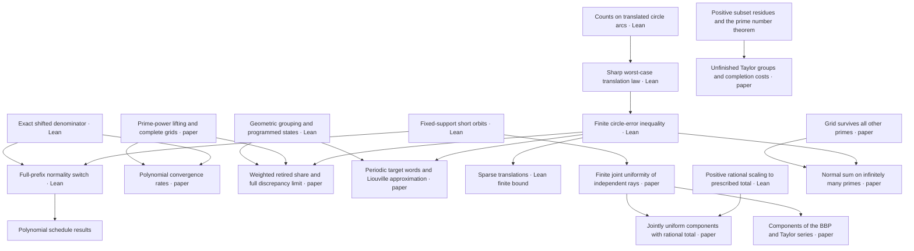

# Phase 18 proof dependencies

The arrows below indicate implications used in the proofs. Labels describe the evidence at the arrow's destination. The earlier [library map](../../docs/framework.md) identifies the common Lean infrastructure.

The geometric identity identifies the raw and grouped numbers. The modular denominator proof works directly with the grouped coefficients. The positive-period argument determines explicit rates only where incomplete periods have sufficiently small total length. The broader qualitative criterion uses the independent [fixed-support orbit theorem](../../NormalityChecker/SmoothOrbit.lean). The growing-prime construction replaces that fixed-support input with a uniform Chinese remainder theorem calculation. [Principal family](principal.md) · [Programmable discrepancy](programming.md) · [Infinite sums](summation.md)

The sharp translation identity follows from circle arcs and invariance of interval discrepancy under rigid rotations. The entropy classification of translations preserving normality uses Rauzy's theorem externally. The signed-shell test first uses the two empirical component limits of Paper III and then affinity of entropy. The Liouville construction uses rational approximations with a strictly positive error and an independently bounded denominator. [Translations](translations.md) · [Primary sources](sources.md) · [Liouville construction](liouville-realization.md)

Growth of the odd denominator at original Taylor cutoffs and the existence of finite dyadic groups can hold simultaneously. The subset-residue argument bounds when each group can finish. The differential-algebra obstruction instead concerns identities of formal series and uses no digit theorem. Each conclusion about the distribution of a **classical component** stops at that component. [Taylor delays](prime-delay.md) · [Functional identities](functional-obstruction.md) · [Classical scope](classical.md)
